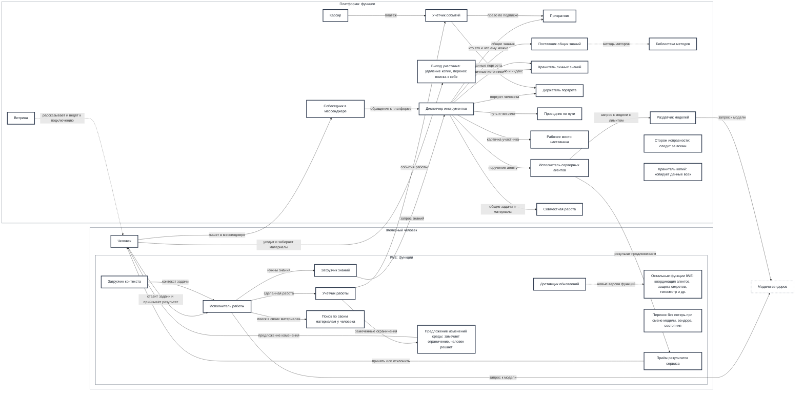
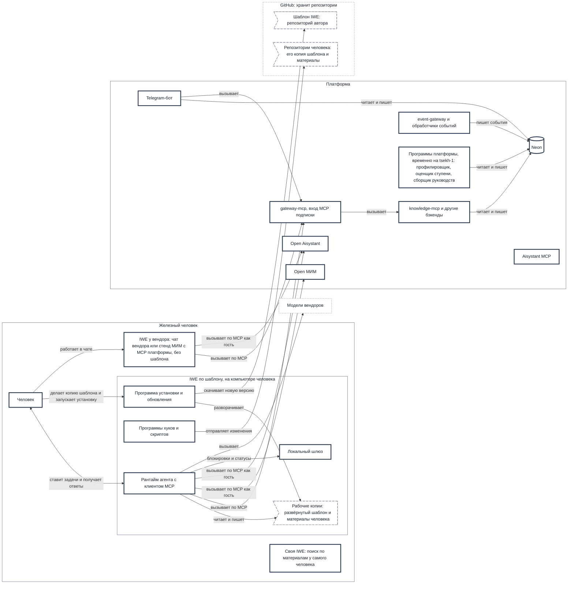

# Архитектура платформы и IWE

**Для кого:** Архитектор, разработчики.
**На какой вопрос отвечает:** как устроены платформа и IWE: функциональные подсистемы, модули, размещение, MCP, данные, сквозные пути и связь «потребность → функциональная подсистема → модуль».
**Кто ведёт:** это стартовая архитектура, черновик написал автор экосистемы; детализацию и правки ведёт команда разработки запросами на слияние.
**Чего здесь не искать:** зачем всё это и что развивается — [ECO.CONCEPT.001 Концепция экосистемы](https://github.com/MimEcoSys/PACK-ecosystem/blob/main/pack/ecosystem/02-domain-entities/ECO.CONCEPT.001-ecosystem-concept.md); формулировки потребностей — [DP.MAP.005 Потребности](https://github.com/MimEcoSys/PACK-digital-platform/blob/main/pack/digital-platform/07-map/DP.MAP.005-mcp-scenarios.md); что работает на выпуске, что строится и что проверить — [«Состояние по потребностям»](https://github.com/aisystant/DS-ecosystem-development/blob/main/C.IT-Platform/C2.IT-Platform/C2.3.Operations/Goals-State/state-by-goals.md) (рабочий документ, ведут тестировщик и выпускающий).

**Пять документов и как они связаны.** Набор описан в общем документе [«Пять документов экосистемы»](https://github.com/MimEcoSys/PACK-ecosystem/blob/main/pack/ecosystem/07-map/ECO.MAP.003-five-documents.md) (ECO.MAP.003, пак экосистемы). Этот документ — третий: как устроены платформа и IWE.
- **Получает** номер потребности из [«Потребностей»](https://github.com/MimEcoSys/PACK-digital-platform/blob/main/pack/digital-platform/07-map/DP.MAP.005-mcp-scenarios.md) и связывает его с подсистемой и модулем (§11.2 «Средства по потребностям»).
- **Передаёт** подсистемы и модули [«Состоянию по потребностям»](https://github.com/aisystant/DS-ecosystem-development/blob/main/C.IT-Platform/C2.IT-Platform/C2.3.Operations/Goals-State/state-by-goals.md): там по ним ставится состояние. Обратно в этот документ состояние не возвращается.
- **Почему так решено** — в [рабочих записях](https://github.com/aisystant/DS-ecosystem-development/tree/main/C.IT-Platform/C2.IT-Platform/C2.3.Operations/Goals-State/working-records).

> **Implementation Note.** Конкретные вендоры (Neon, Cloudflare Workers, ORY) упоминаются как текущая реализация. Доменные концепции (функциональные подсистемы, слои, ЭМОГССБ, принципы, IPO-паттерн) не зависят от вендора. Детали реализации: [C2.IT-Platform](https://github.com/aisystant/DS-ecosystem-development/tree/main/C.IT-Platform/C2.IT-Platform).

<details><!-- fold -->
<summary>
<a id="1-назначение"></a>

## 1. Назначение

</summary>

Документ описывает платформу и IWE как прозрачный ящик: границы систем, функциональные подсистемы, модули и их размещение, MCP, данные, сквозные пути, архитектурные характеристики и принципы проектирования. Одно описание заменяет прежние «Архитектуру платформы» (DP.ARCH.001 v1.0) и «Архитектуру IWE» (DP.IWE.013).

- **IWE** — наш бренд ИИ-среды в любом из трёх состояний: у вендора (чат вендора с подключённым MCP платформы, без шаблона: инструкции даёт MCP; вендор — Claude, ChatGPT или МИМ со стендом iwe.system-school.ru, «браузерная IWE МИМ»), по шаблону на своём компьютере, своя. У каждого человека свой экземпляр IWE, и управляет им он сам. Тип «три состояния ИИ-среды» описан в концепции экосистемы; как состояния соотносятся с видами IWE в учёте изменений — таблица ниже.
- **Шаблон IWE.** В нём лежат описания и файлы программ; шаблон хранится в репозитории автора на GitHub. Человек делает копию шаблона в свой GitHub и запускает программу установки, она разворачивает копию на компьютере. Новые версии программа обновления скачивает прямо из репозитория автора, а не из копии человека. Свои материалы человек хранит в своих репозиториях на GitHub.
- **Платформой** управляет организация. В ней 16 функциональных подсистем (§4.1) и модули на Cloudflare, Railway, Neon и VK Cloud (§5.1); часть модулей временно работает на личном сервере автора tsekh-1 (§2). Для IWE платформа служит системой окружения.
- **MCP** — открытый протокол, описание. Сервер MCP относится к программам и служит модулем платформы. Для IWE он находится вне границы: внутри IWE работают только клиент MCP в рантайме и локальный шлюз.
- **Потребности человека** определены в DP.MAP.005; здесь они связаны с устройством цепочкой «потребность → средство → подсистема → модуль» (§11).

**Состояния ИИ-среды и виды IWE в учёте изменений** (цепочка учёта — общий документ о наборе ECO.MAP.003):

| Состояние ИИ-среды (концепция) | Вид IWE в учёте изменений | Чьи документы меняются |
|---|---|---|
| у вендора, в том числе стенд МИМ | IWE у вендора | программы MCP; настройка стенда (подключённые MCP, инструкции) |
| по шаблону на своём компьютере | IWE по шаблону | шаблон IWE |
| своя | не учитывается: её собирает сам человек, а от нас ей нужны MCP, выгрузка данных и путь перехода на свою ИИ-среду; их изменения учитываются как изменения MCP или шаблона | документы человека; в учёт не входит |
| экземпляр разработчика (не состояние концепции; экземпляр автора для обкатки) | IWE у разработчика: в нём работают системы, которых в шаблоне ещё нет | до людей они доходят, когда их документы записаны в шаблон и вышли в его релизе |

**Что из этого уже работает** — в документе 4 [«Состояние по потребностям»](https://github.com/aisystant/DS-ecosystem-development/blob/main/C.IT-Platform/C2.IT-Platform/C2.3.Operations/Goals-State/state-by-goals.md). Здесь описано устройство без отметок состояния: на схемах и в таблицах показаны и действующие, и задуманные функции и модули.

</details><!-- /fold -->

<details><!-- fold -->
<summary>
<a id="2-системы-и-границы"></a>

## 2. Системы и границы

</summary>

IWE — система. Пользователь — отдельная система вне IWE. **IWE как целое взаимодействует с пользователем, и вместе они создают рабочие продукты**: планы, тексты, знания в паках, код, решения. Пользователь ставит задачи и принимает решения; IWE исполняет работу агентами, держит знания и порядок работы. Их совместная система — железный человек.

| Граница | Как проходит | Тест |
|---|---|---|
| Человек и IWE | человек вне IWE, вместе они система «железный человек» | можно ли заменить IWE, не меняя человека |
| IWE и платформа | по тому, чей это экземпляр | модуль IWE — экземпляр, который человек заводит и настраивает для себя; модуль платформы — общий экземпляр организации |
| Платформа и окружение | система окружения — площадка или сервис, которыми организация только пользуется; она заменяема | наш ли это экземпляр: наши базы в Neon и воркеры на Cloudflare — модули платформы, Neon и Cloudflare как сервисы — окружение |

Граница IWE проходит между её модулями и системами окружения (§5.2, §5.4).

**Где тест не даёт ответа, пишем «не определено»**, а не втискиваем модуль в одну из сторон. Сейчас так: learning-context-service — не установлено, где он работает и чей это экземпляр.

**Одна платформа, две организации.** Платформу делает одна команда для двух организаций: Aisystant Corp (мир) и МИМ (Россия). Команда строит общий фундамент так, чтобы общего было как можно больше, а раздельно делает только то, чего требуют условия работы в мире и в России. Знания и Библиотека методов могут лежать в одном месте; MCP разворачивается в двух местах, хотя код у них может быть общим. Операторы у развёртываний разные.

**Почему открытый доступ — часть платформы, а не отдельная система.** Открытая выдача знаний — функция Поставщика общих знаний, а Open МИМ и Open Aisystant — модули платформы: это общие экземпляры той же организации, что ведёт остальную платформу (тест второй строки таблицы). Отдельными являются развёртывания по организациям, а не функция.

**Где работают агенты по расписанию.** На платформе, по подписке; человек получает их результат как сервис в свою IWE. Результат приходит предложением, человек принимает или отклоняет его.

**Временное размещение на сервере tsekh-1.** tsekh-1 — личный сервер автора, а не площадка платформы. Временно на нём работают программы платформы, которые по расписанию выполняют работы для всех людей: профилировщик, оценщик ступени, контроллер онбординга, сборщик руководств, синхронизатор реестра платежей, программа резервного копирования restic, якорение OpenTimestamps. Это модули платформы на чужом для неё ресурсе; их работы — работы этих модулей, а не модули. Всё платформенное с этого сервера переносится в GKE или VK Cloud (решение автора 05.11.2026); пока перенос не сделан, отказ сервера затрагивает всех участников (долг переноса — §20). Установка IWE автора на том же сервере — частный случай одной IWE, в этом описании она не показана.

**Системы, релизы и Выпускающие.** Изменение относится к системе, релиз — к её документам: релиз — проверенная и выданная людям версия документов системы (программ, настроек, инструкций) с меткой, в которой выходит набор изменений. У каждой системы свои релизы и свой Выпускающий (описание роли — DP.ROLE.120); выкат — отдельная работа по развёртыванию версии (§7.3). Цепочка учёта — ECO.MAP.003.

| Система | Что выходит в релизе | Выпускающий | Кто держит обещания |
|---|---|---|---|
| IWE по шаблону | версия шаблона: российский — в аккаунте автора, мировой — в организации `iwesys`; релиз записывает зависимость «требует перечня инструментов версии M» и содержит контрактную спецификацию перечня (§7.3) | Дмитрий Смирнов — российский шаблон; мировой — не назначен | не назначено (сверка обещаний впереди) |
| Open и Plus по регионам: Open Aisystant, Open МИМ, Aisystant MCP, MIM MCP (§7.1) | версия программ MCP | Андрей | не назначено (сверка обещаний впереди) |
| Переходный шлюз mcp.aisystant.com (до отключения) | правки кода выкатываются на Cloudflare; серверная часть релиза шаблона — по варианту, который выберет Дмитрий (§7.3) | своего Выпускающего нет | не назначено (сверка обещаний впереди) |
| Стенд iwe.system-school.ru (LibreChat с подключёнными MCP; IWE у вендора, вендор — МИМ) | версия настройки LibreChat: подключённые MCP и инструкции | Паша | не назначено (сверка обещаний впереди) |
| Бот МИМ | код бота: сначала пилотный экземпляр, затем основной | автор | не назначено (сверка обещаний впереди) |
| Сайты платформы, прочие программы платформы | код и тексты | не назначен | не назначено (сверка обещаний впереди) |

В столбце «Система» документа 4: IWE у вендора раскладывается на программы MCP (Open, Plus, переходный шлюз) и стенд; IWE у разработчика системой не ставится — изменение пишется за системой, куда идёт работа (обычно IWE по шаблону), с отметкой «Где заметно: у разработчика».

</details><!-- /fold -->

<details><!-- fold -->
<summary>
<a id="3-какие-описания-здесь-есть"></a>

## 3. Какие описания здесь есть

</summary>

Одна система описывается с нескольких точек зрения. Каждое описание отвечает на свой вопрос.

| Описание | Вопрос | Раздел |
|---|---|---|
| Функциональное | какие функции выполняет система и какими подсистемами | 4.1, 4.2 |
| Слои | через какие слои проходит запрос | 4.3 |
| Свидетельства результата | где лежат свидетельства пяти измерений результата | 4.4 |
| Модульное | из каких именованных программ и баз собрана | 5 |
| Размещение | где что работает и чей это ресурс | 6 |
| MCP и интерфейсы | через что клиенты обращаются к системе | 7 |
| Данные | что где лежит и кто владелец | 8 |
| Сквозные пути | как идёт работа через модули | 10 |
| Соответствия и средства по потребностям | какие модули реализуют подсистему и какие средства служат потребности | 11 |

**Функциональная подсистема** — часть IWE или платформы при функциональном разбиении: выделена и названа по функции, которую выполняет для целого: «Маршрутизатор знаний», «Защитник секретов». Так в инженерии называют функциональные объекты («насос», «двигатель»): имя говорит, что объект делает, а не из чего собран. Та же система разбивается и другим способом — на модули (§5). Это два разбиения одного целого, а не два набора частей. Подсистему узнают по функции: собственного состава модулей у неё нет, ей распределены модули, и это распределение записано в соответствиях «функциональная подсистема → модуль» вместе с условием, когда модуль работает на подсистему (§11.1). Одна подсистема держится на нескольких модулях, один модуль работает на несколько подсистем.

**Модуль** — конкретный физический объект с собственным названием: программа, запущенная на железе (Claude Code, `session-guard.sh`), или служба (systemd). Модуль можно установить и заменить. База данных, очередь, кеш и бакет — тоже модули: это экземпляры, которые заводят, выключают и заменяют; данные в них — не модули. Файлы, которые модуль читает и пишет, и репозитории как совокупности таких файлов — документы, не модули. Это не учебный модуль: запрет пака на дидактические слова («шаг», «урок», «модуль») относится к учебному смыслу.

**Программа** (скрипт и хук — тоже программы) — система, когда её файл запущен на железе. Незапущенный файл программы — документ.

**Документ** — предмет в отношении носителя: тот же предмет может быть системой, если проходит критерий (книга, паспорт); описание системой не бывает. Репозиторий раскрывается на три предмета: содержимое файлов (описания), копия на диске или в хостинге (носитель), копия вместе с работающими git и хостингом (система в роли хранителя).

От набора FPF E.17.2 описание отличается так: процедурная точка зрения (ОРЗ, конвейеры) — в методах подсистем (§4.2) и их описаниях; распределение ответственности — в соответствиях (§11); размещение добавлено как отдельная точка зрения.

<details><!-- fold -->
<summary>
<a id="схема-1-функциональная-что-делают-части-и-что-между-ними-передаётся"></a>

### Схема 1. Функциональная: что делают части и что между ними передаётся

</summary>

Здесь нет программ, баз и MCP-серверов: только функции платформы и IWE и то, что они передают друг другу. Функция и модуль — разные точки зрения на одну систему, они связываются назначением «какой модуль выполняет какую функцию» (FPF, A.6.F:4.6 и A.6.M). Запущенная программа — модуль, а не функциональная часть: её место на схеме 2. Поэтому три состояния IWE здесь не показаны: это три способа выполнить одни и те же функции разными модулями. Шаблон и репозитории относятся к документам, а не к функциям, они тоже на схеме 2. Сторож исправности и Хранитель копий обслуживают все подсистемы, их стрелки не рисуем.



</details><!-- /fold -->

<details><!-- fold -->
<summary>
<a id="схема-2-модульная-какие-программы-выполняют-эти-функции"></a>

### Схема 2. Модульная: какие программы выполняют эти функции

</summary>

Здесь названы программы, базы и серверы, то есть модули, и показано, где лежат документы. Показаны три состояния IWE и не все модули платформы, а те, что нужны, чтобы увидеть путь запроса. Полный перечень — раздел 5, размещение — раздел 6.



**Обозначения для обеих схем.** Фон у всех объектов белый. Сплошной толстой рамкой показаны системы под нашим управлением: человек, программа, база данных (цилиндром). Мелким пунктиром показаны системы окружения, ими управляет не организация. Флажком с длинным пунктиром показаны документы. Сплошная стрелка идёт от системы, которая действует: вызывает, читает, пишет. Документы сами ничего не делают, поэтому стрелки идут только к ним: программа читает, разворачивает или скачивает документ, GitHub их хранит (рамка вокруг двух документов). На схеме 1 пунктирная стрелка — связь не по вызову: показ, обновление, самостоятельная сборка, связь с Библиотекой методов.

</details><!-- /fold -->

</details><!-- /fold -->

<details><!-- fold -->
<summary>
<a id="4-функциональное-описание"></a>

## 4. Функциональное описание

</summary>

<details><!-- fold -->
<summary>
<a id="41-платформа"></a>

### 4.1. Платформа

</summary>

Подсистемы платформы названы по функции, которую они выполняют для целого.

| Подсистема | Что делает для целого | Модули |
| --- | --- | --- |
| Привратник | устанавливает личность, тариф и права | Ory, часть gateway-mcp, user-profile-service, bridge-scope-service |
| Диспетчер инструментов | принимает вызовы MCP и передаёт их нужному бэкенду | gateway-mcp |
| Поставщик общих знаний | ищет и выдаёт паки, руководства, понятия | knowledge-mcp, guides-mcp, open.system-school.ru (Open МИМ), open.aisystant.com (Open Aisystant) |
| Библиотека методов | хранит указатели на методы авторов и их проверку; определение — [ECO.ARCH.001 §3.1 «Библиотека методов»](https://github.com/MimEcoSys/PACK-ecosystem/blob/main/pack/ecosystem/02-domain-entities/ECO.ARCH.001-ecosystem-architecture.md) | модуль и данные проектируются; войдут сюда, когда будут определены |
| Хранитель личных знаний | индексирует и отдаёт личные и командные источники | personal-knowledge-mcp, github-integration-service |
| Держатель портрета | хранит характеристики и ступень человека | digital-twin-mcp, learning-context-service, профилировщик, оценщик ступени |
| Проводник по пути | ведёт человека: онбординг, чек-лист, руководство, тренажёр | fsm-mcp, checklist-mcp, контроллер онбординга, сборщик руководств, iwe-guide-web, simulator |
| Учётчик событий | принимает события и раскладывает их по базам, начисляет баллы | event-gateway, trace-accountant, activity-hub, мост LMS, обработчик проекций |
| Кассир | принимает платежи и ведёт подписки | payment-receiver, синхронизатор реестра платежей |
| Рабочее место наставника | даёт наставнику карточку участника и разбор чата | mentorship-service, chat-analyst-service |
| Исполнитель серверных агентов | выполняет работу агентов по поручению и расписанию | agent-runner, hermes-agent, agent-status-service |
| Раздатчик моделей | проверяет лимит и передаёт вызовы моделям | iwe-llm-proxy, litellm |
| Собеседник в мессенджере | ведёт диалог с человеком в Telegram | Telegram-бот, прежний бот Школы |
| Витрина | рассказывает о программах и ведёт к подключению | system-school.ru, aisystant-com, ssm2025 |
| Сторож исправности | замечает сбои и сообщает о них | observability-webhook, status-proxy |
| Хранитель копий | держит резервные копии и подтверждение целостности | restic и якорение OpenTimestamps (временно на tsekh-1), бакет в Backblaze B2 |

**Роли платформы как целого** описаны иначе: поставщик знаний, поставщик среды и обновлений, учёт и признание. Человек пользуется платформой целиком «как поставщиком знаний», а состоит она из подсистем выше.

**Поставка шаблона IWE** здесь не подсистема платформы. Её ведёт отдельный конвейер шаблона.

</details><!-- /fold -->

<details><!-- fold -->
<summary>
<a id="42-iwe"></a>

### 4.2. IWE

</summary>

Для каждой: что делает, по какому описанию метода работает и какие рабочие продукты создаёт. В колонке «Метод» — только описания методов: ID пака или файл SKILL.md шаблона; где общего описания метода нет, так и сказано, а частные приёмы названы отдельно. «Ядро» — подсистема есть в любой установке по шаблону; «по выбору» — подключается пользователем.

| Функциональная подсистема | Что делает | Метод (описание) | Рабочие продукты | Где есть |
|---|---|---|---|---|
| Исполнитель работы | выполняет задачи пользователя действиями агента | культура работы IWE (DP.M.008); протоколы ОРЗ шаблона (`memory/protocol-*.md`) | рабочие продукты по задачам: тексты, код, планы, правки паков | ядро |
| Загрузчик контекста | подаёт агенту инструкции и память по событиям сессии, держит резервную копию памяти (прежнее имя — экзокортекс) | модульный экзокортекс (DP.EXOCORTEX.001) | контекст сессии агента; снимок перед сжатием беседы; копия памяти | ядро |
| Маршрутизатор знаний | определяет место хранения для каждой единицы знания и артефакта | маршрутизация знаний (DP.KR.001), гейт маршрутизации (DP.SC.036), пользовательская карта (DP.KR.002) | записи знаний в нужных паках и хранилищах; отчёты извлечения знаний | ядро |
| Маршрутизатор задач | передаёт задачу нужному исполнителю: скрипту, модели или скиллу | маршрутизатор задач IWE (DP.SC.159) | разобранный запрос с меткой маршрута | ядро |
| Защитник секретов | не пропускает секреты и личные данные в команды, вывод и коммиты; проверяет согласие на доступ к личным данным | общее описание метода не выделено; SKILL.md `check-secret`; частный приём — узкая граница сканирования (DP.M.450) | отказы и маскирование в журнале; отчёт сканирования секретов | ядро |
| Контролёр реестров | обнаруживает расхождения установки с манифестом шаблона | общее описание метода не выделено; механизм — манифест синхронизации шаблона (`.claude/sync-manifest.yaml`); частный приём — детектор структурного расхождения (DP.M.111) | отчёт о расхождениях | ядро |
| Фоновый дежурный | запускает работы по времени и событиям и сигналит пользователю | SKILL.md `day-open`; распределение ночного окна (`docs/agent-coordination-manifest.md` §4 шаблона) | план дня, сводки, напоминания | ядро |
| Техосмотрщик | проверяет установку и выдаёт заключение | SKILL.md `audit-installation`; смежное — каденция аудита безопасности (DP.M.013) | заключение аудита установки | ядро |
| Учётчик работы | ведёт сессии, рабочие продукты, реестр и журнал дня | состояния рабочего продукта (DP.M.010); протоколы открытия и закрытия шаблона | карточки и реестр рабочих продуктов, файлы сессий, журнал дня | ядро |
| Координатор агентов | разграничивает правки параллельных агентов, изолирует их, выстраивает публикацию, ведёт диалог агентов | мульти-агентная диалоговая сессия (DP.SC.154); сверка параллельных сессий (DP.METHOD.120); `docs/agent-coordination-manifest.md` шаблона | отметки сессий, квитанции публикации, отчёты диалоговых сессий | ядро |
| Доставщик обновлений | доставляет обновления шаблона в установку пользователя | шаблон и установка IWE (DP.IWE.002); SKILL.md `iwe-update` | обновлённая установка, разбор изменений | ядро |
| Загрузчик знаний | получает для агента документы паков и личных знаний | архитектура шлюза (DP.IWE.003) | найденные документы и выдержки в контексте агента | ядро |
| Контролёр ясности | проверяет ответы агента пользователю на понятность | единый разговорный стиль агентов (DP.SC.050) | предупреждения и журнал нарушений стиля | по выбору |
| Табло работы | показывает пользователю состояние рабочих продуктов в редакторе | описание метода не выделено | вид состояния рабочих продуктов | по выбору |
| Учётчик времени | отмечает время работы пользователя в рантайме и редакторе | SKILL.md `setup-wakatime` | отметки времени; сводки времени во внешнем сервисе | по выбору |
| Детектор | на событиях рантайма запускает зарегистрированные детекторы и записывает найденные ими события (инциденты, кандидаты в знания) | общее описание метода не выделено; механизм — шина захвата (обещание DP.SC.025), каталог типовых ошибок агента (DP.FM.010) | события захвата и инцидентов в журналах | ядро |
| Учёт рассуждений агента | записывает следы действий и рассуждений агента по сессиям, выдаёт их для просмотра, поиска и разбора | общее описание метода не выделено; механизм — обещание хранения следов агента (DP.SC.037) | журнал следов агента; выдача следов по сессии, РП или дате | по выбору (запись по умолчанию выключена, включает пользователь) |

«Маршрутизатор знаний» (куда записать) и «Маршрутизатор задач» (кому поручить) — разные подсистемы. В таблице «Средства по потребностям» (§11) встречаются ещё четыре имени — Хранитель, Наладчик IWE, Проводник развития, Публикатор релизов: это кандидаты в подсистемы IWE, в список выше не приняты.

**Решения пилота 10.11.2026 по кандидатам из ролей** (проверка по шаблону: принимается подсистема, у которой в шаблоне есть программа). Приняты: Детектор, Учёт рассуждений агента. Не приняты: Сторож допуска и Контролёр стиля кода — их программы проверки есть только в установке автора (в шаблоне у стиля кода — только подача правил агенту); Публикатор материалов практикума — роль вне IWE; Верификатор — в шаблоне есть только описание скилла `/verify` (SKILL.md), то есть инструкция агенту; инструкция системой не является, система — агент, который её исполняет, поэтому Верификатор — роль, которую играет агент. Переводчик — кандидат, уровень не решён.

Целевое направление «агенты по вызову из общей очереди задач» (§9.4) развивает Фонового дежурного, Координатора агентов и Маршрутизатора задач; отдельной подсистемы не вводит.

Инструкции, память, протоколы и паки — описания; описания скиллов хранят файлы SKILL.md (документы). С ними работают подсистемы; ни подсистемами, ни модулями они не являются.

**Договорённость о работе.** По концепции экосистемы (раздел 4 «Что создаётся в работе») у каждой работы две отметки: предмет с ожидаемым изменением и участие среды — «сделай за меня» или «тренируй меня». Держит их Учётчик работы в карточке работы. В шаблоне этих отметок пока нет; добавить их — изменение шаблона (функция в списке «Функции, которых не хватает» DP.MAP.005).

**Чем выполняются функции IWE в трёх состояниях.** Функции те же, модули разные. Что из этого уже работает и на каком выпуске проверено — отметками в документе 4 «Состояние по потребностям».

| Функциональная подсистема | IWE у вендора | По шаблону на компьютере | Своя |
|---|---|---|---|
| Исполнитель работы | чат вендора | рантайм агента (Claude Code и др.) | рантайм, который выбрал человек |
| Загрузчик контекста | инструкции, выданные MCP | хуки и файлы шаблона (§11.1) | не определено |
| Загрузчик знаний | сейчас — переходный шлюз; после переключения региона — Open и Plus своего региона (§5.4, §7.3) | клиент MCP рантайма, напрямую или через `local-gateway`; сейчас — к переходному шлюзу, после переключения региона — к Open и Plus своего региона (§7.3) | Plus своего региона рядом со своим поиском |
| Учётчик работы | не определено | скрипты и хуки шаблона (§11.1) | не определено |
| Защитник секретов | модулей IWE нет: действуют только защиты вендора и платформы | хуки и скрипты шаблона (§11.1) | не определено |
| Остальные подсистемы | модулей IWE нет | §11.1 | не определено |

Стенд iwe.system-school.ru («браузерная IWE МИМ») — IWE у вендора, вендор — МИМ: функции выполняются так же, как в колонке «IWE у вендора»; настройку стенда выпускает Паша (§2).

</details><!-- /fold -->

<details><!-- fold -->
<summary>
<a id="43-слои-платформы-вид-по-потоку-запроса"></a>

### 4.3. Слои платформы: вид по потоку запроса

</summary>

Слои — отдельный вид описания рядом с функциональным: они показывают, через что проходит запрос, а не что делает каждая часть.

```
┌─────────────────────────────────────────────────────────────┐
│  СЛОЙ 3: ИНТЕРФЕЙСЫ (тонкие клиенты)                        │
│  Telegram-бот │ клиенты MCP │ сайты Витрины │ iwe-guide-web  │
└───────────────────────────┬─────────────────────────────────┘
                            ▼
┌─────────────────────────────────────────────────────────────┐
│  СЛОЙ 2: ОБРАБОТКА                                           │
│  ┌─────────────────────────┐  ┌───────────────────────────┐ │
│  │ Зона А: ИИ-системы      │◄►│ Зона Б: Детерминированные │ │
│  │ (модель, без состояния) │  │ (код, с состоянием, MCP)  │ │
│  │ agent-runner (Стратег,  │  │ gateway-mcp и MCP-бэкенды,│ │
│  │ Экстрактор),            │  │ event-gateway и проекции, │ │
│  │ hermes-agent            │  │ payment-receiver, Ory,    │ │
│  │                         │  │ user-profile-service, …   │ │
│  └─────────────────────────┘  └───────────────────────────┘ │
└───────────────────────────┬─────────────────────────────────┘
                            ▼
┌─────────────────────────────────────────────────────────────┐
│  СЛОЙ 1: ДАННЫЕ + ИНФРАСТРУКТУРА                             │
│  GitHub │ Neon (pgvector, pg_trgm) │ Railway Postgres │      │
│  KV, D1 и очереди Cloudflare │ Backblaze B2                  │
└─────────────────────────────────────────────────────────────┘
```

| Слой | Назначение | Характер | Модули |
|------|------------|----------|--------|
| **3. Интерфейсы** | Точки входа для людей | Тонкие клиенты, без бизнес-логики | Telegram-бот; клиенты MCP: рантаймы агентов и чаты вендоров; сайты Витрины; iwe-guide-web |
| **2. Обработка** | Логика, принятие решений, доступ к данным | Две зоны (см. ниже) | ИИ-системы и детерминированные программы |
| **1. Данные** | Хранение данных | Физическое хранение | GitHub, Neon (pgvector, pg_trgm), Railway Postgres, KV, D1 и очереди Cloudflare, Backblaze B2 |

**Зоны слоя обработки.** Слой 2 содержит два типа систем, которые работают как **пиры** (горизонтальное взаимодействие):

| Зона | Характер | Состояние | Стоимость | Тестирование | Модули |
|------|----------|-----------|-----------|-------------|------------|
| **А: ИИ-системы** | Недетерминированные, модель | Без состояния | Высокая (токены) | Вероятностное | agent-runner (Стратег, Экстрактор), hermes-agent; вызовы моделей идут через Раздатчика моделей |
| **Б: Детерминированные** | Детерминированные, код | С состоянием | Низкая | Точное | gateway-mcp, knowledge-mcp, digital-twin-mcp, personal-knowledge-mcp, checklist-mcp, fsm-mcp, guides-mcp, event-gateway и обработчик проекций, payment-receiver, user-profile-service, Ory |

**Правила взаимодействия:**
- Интерфейс (слой 3) обращается к обработке (слой 2) — к любой зоне
- Зоны А и Б взаимодействуют горизонтально (ИИ вызывает MCP, MCP возвращает данные)
- Обработка (слой 2) обращается к данным (слой 1)
- Интерфейс **не** обращается к данным напрямую
- ИИ-система **не** знает, какой UI у пользователя

**Расхождение с правилом.** Telegram-бот сейчас читает и пишет базы Neon напрямую (схема 2), минуя слой обработки. Это долг: бот должен быть тонким клиентом и обращаться к платформенным программам.

</details><!-- /fold -->

<details><!-- fold -->
<summary>
<a id="44-пять-измерений-результата-где-свидетельство-и-кто-его-держит"></a>

### 4.4. Пять измерений результата: где свидетельство и кто его держит

</summary>

Концепция экосистемы меряет результат работы пятью измерениями (раздел 9 «Как проверяется развитие»). Отдельной подсистемы учёта измерений нет: свидетельства лежат у разных подсистем.

| Измерение | Где свидетельство | Кто держит |
|---|---|---|
| Результат проекта | рабочий продукт у получателя; решение о приёмке внешней работы (потребность 99) | Учётчик работы (IWE) — карточка работы; признание результата — функция, которой не хватает (DP.MAP.005) |
| Мастерство человека | характеристики и ступень в цифровом двойнике | Держатель портрета (платформа) |
| ИИ-среда | новая версия описаний среды в Git установки человека | репозитории человека; предложение изменений среды — функция, которой не хватает |
| Способность начать следующий цикл | события работы: кто запустил следующий шаг | не определено: события собирает Учётчик событий, меры нет |
| Распространение методов | применение метода другими | Библиотека методов (модуль проектируется) |

Четыре оси состояния участника в DP.MAP.005 (потребности 61, 65) — другой предмет: они показывают, где участник застрял на пути, а не чем измерен результат работы.

</details><!-- /fold -->

</details><!-- /fold -->

<details><!-- fold -->
<summary>
<a id="5-модульное-описание"></a>

## 5. Модульное описание

</summary>

<details><!-- fold -->
<summary>
<a id="51-платформа"></a>

### 5.1. Платформа

</summary>

Перечень снят из конфигураций. Модуль — программа, база данных или сервер, то, что можно выключить. Работа — действие модуля за период, копии и якоря — данные, таймер — описание расписания в конфигурации. Поэтому в строках названы программы, а работы указаны в колонке «Что делает». Строки «Модуль IWE, не платформы» и документ `knowledge-mcp-template` оставлены, чтобы показать границу. Программы установки IWE у разработчика на сервере tsekh-1 сюда не входят (§2).

| Модуль | Подсистема | Что делает | Где работает | Обращается к |
| --- | --- | --- | --- | --- |
| gateway-mcp (воркер gateway-mcp-v2) | Диспетчер инструментов | Единая точка входа MCP: проверяет вход через Ory, подписку и права, собирает инструменты из программ-источников и перенаправляет вызовы; держит OAuth-шлюз. | Cloudflare Workers | knowledge-mcp (привязка воркера), digital-twin-mcp, personal-knowledge-mcp, chec |
| TokenRefreshCoalescer (Durable Object шлюза) | Диспетчер инструментов | Объединяет одновременные обновления токена, чтобы не гонять Ory лишними запросами. | Cloudflare Workers | Ory Hydra |
| REFRESH_TOKEN_KV (хранилище ключ-значение шлюза) | Диспетчер инструментов | Кеш токенов обновления для входа через OAuth. | Cloudflare Workers | - |
| kimi-adapter (mim-iwe) | Диспетчер инструментов | Демо-стенд и HTTP-адаптер: держит MCP-клиент к gateway-mcp для браузерного доступа. | не установлено | gateway-mcp, Ory |
| knowledge-mcp (общий воркер знаний платформы) | Поставщик общих знаний | Поиск, чтение и обход платформенных знаний (Паки, руководства, понятия) в режиме public; индексирует репозитории по расписанию. | Cloudflare Workers | Neon (БД knowledge, схемы public и concept_graph, pgvector), OpenRouter и OpenAI |
| full-ingest-batches (очередь и очередь отказов) | Поставщик общих знаний | Очередь пакетов полной индексации знаний; отказавшие пакеты уходят в full-ingest-batches-dlq. | Cloudflare Workers | - |
| guides-mcp (руководства) | Поставщик общих знаний | Список, разделы, текст и смысловой поиск по платформенным руководствам из таблицы knowledge_chunk. | Cloudflare Workers | Neon (knowledge_chunk с source=docs-courses), OpenRouter (эмбеддинги) |
| open-tserenov-com (открытый личный MCP Церена) | Поставщик общих знаний | Публичный MCP search/fetch по открытому авторскому корпусу из встроенного бандла; ограничивает частоту обращений. | Cloudflare Workers | D1, бандл корпуса |
| D1 open-tserenov-com | Поставщик общих знаний | База D1 открытого личного MCP (назначение таблиц в этой проверке не снято). | Cloudflare Workers | - |
| open.system-school.ru (гостевой MCP FPF) | Поставщик общих знаний | Анонимный MCP search/fetch по гиду FPF на MiniSearch и встроенном бандле. | VK Cloud | бандл корпуса FPF |
| plus.system-school.ru (MIM MCP, российский MCP по аккаунту и подписке; целевой) | Поставщик общих знаний | Развёртывание кода Plus Андрея с российскими настройками (§7.1). Прежнее имя `mcp.system-school.ru`: по DP.MAP.004 — российский вход в gateway-mcp, по содержимому репозитория — копия гостевого сервера open.system-school.ru. | VK Cloud | - |
| personal-knowledge-mcp (воркер личных знаний) | Хранитель личных знаний | Личные источники пользователя: поиск, запись, переиндексация личных репозиториев; применяет защиту записи по правам. | Cloudflare Workers | Neon (схема knowledge, БД indicators), OpenRouter, GitHub App, bridge-scope-serv |
| reindex (очередь и очередь отказов) | Хранитель личных знаний | Очередь переиндексации личных источников; отказавшие сообщения — в reindex-dlq. | Cloudflare Workers | - |
| knowledge-mcp-template (документ: заготовка воркера знаний пользователя; не модуль, по ней собирают модуль в чужой среде) | Хранитель личных знаний | Заготовка воркера для личного источника знаний пользователя: схема, индексатор, wrangler.toml. | Cloudflare Workers | Neon или иная БД пользователя, sources.json |
| github-integration-service | Хранитель личных знаний | Принимает вебхуки GitHub App и OAuth установки, создаёт репозитории, ведёт статус подключения пользователя. | Railway | GitHub App, Neon (LEARNING_DATABASE_URL), knowledge-mcp, personal-knowledge-mcp, |
| digital-twin-mcp (цифровой двойник) | Держатель портрета | Читает и пишет поля, профиль и показатели цифрового двойника ученика по метамодели. | Cloudflare Workers | Neon (DATABASE_URL), проверка токенов Ory и подписи шлюза (GATEWAY_JWKS_URL) |
| learning-context-service | Держатель портрета | Согласия, когнитивная справка, состояние онбординга и персональный гид. | не установлено | Neon (LEARNING_DATABASE_URL, DATABASE_URL), Aisystant LMS PG, event-gateway |
| iwe-profiler (Профилировщик) | Держатель портрета | Пересчитывает производные профили в Neon раз в сутки (04:30 по Москве). | tsekh-1, временно; переносится в GKE или VK Cloud | Neon (indicators) |
| iwe-stage-evaluator и iwe-stage-controller | Держатель портрета | Оценивают ступень по данным и вычисляют контроллер ступеней. | tsekh-1, временно; переносится в GKE или VK Cloud | Neon (learning), activity-hub |
| event-gateway (приёмник событий) | Учётчик событий | Единственный писатель событий в learning.domain_event: проверяет источник, подпись и запрет персональных полей. | Cloudflare Workers | Neon (БД learning и persona, переменные DATABASE_URL_LEARNING, DATABASE_URL_PERS |
| trace-accountant | Учётчик событий | Принимает следы работы агентов, пишет в domain_event или в заглушки при отсутствии согласия, сверяет записи. | Railway | Neon (public.domain_event, learning.trace_stubs), Ory |
| activity-hub | Учётчик событий | Собирает события активности (GitHub, WakaTime, LMS), считает стадии и когнитивные справки, хранит счёт в Neon. | Railway | Neon (learning и др.), LMS API, GitHub, WakaTime, event-gateway, Langfuse |
| bridge-2-events-poller | Учётчик событий | Опрашивает legacy LMS (PostgreSQL, чтение) и отправляет события в event-gateway. | Railway | Aisystant LMS PG, event-gateway |
| multi-domain-projection-worker | Учётчик событий | Переносит события из learning.domain_event в БД persona, subscription, indicators, rewards по правилам projection_rules. | Railway | Neon (learning, reference, persona, subscription, indicators, rewards) |
| fsm-mcp (Ассистент Ученика) | Проводник по пути | Выдаёт инструкции по состоянию ученика через конечный автомат; содержит неподключённый модуль проверки результата опроса. | Cloudflare Workers | проверка подписи шлюза (GATEWAY_JWKS_URL), Ory JWKS |
| simulator-proxy | Проводник по пути | Передаёт запросы с simulator.aisystant.com в программу simulator-lab. | Cloudflare Workers | simulator-lab (Railway) |
| checklist-mcp | Проводник по пути | Выдаёт чек-лист участника: факты, этап и прогресс. | Railway | Neon (NEON_DATABASE_URL, PANEL_DATABASE_URL), проверка подписи шлюза |
| iwe-guide-web (читалка руководств, guide.system-school.ru) | Проводник по пути | Показывает персональные и универсальные руководства пилотов IWE. | Railway | Neon (PostgreSQL), GitHub (репозитории DS-personal-guide) |
| simulator-lab | Проводник по пути | Программа-тренажёр, за которой стоит simulator-proxy. | Railway | Neon (политика simulator_ro в migrations 217) |
| iwe-onboarding-controller | Проводник по пути | Контроллер онбординга пользователя (DP.ROLE.046) по таймеру. | tsekh-1, временно; переносится в GKE или VK Cloud | Neon (onboarding_state) |
| iwe-render-pilot-guides (сборщик персональных руководств) | Проводник по пути | Собирает персональные руководства пилотов (день, неделя, очередь). | tsekh-1, временно; переносится в GKE или VK Cloud | git-репозитории пилотов, Claude/LLM-прокси |
| observability-webhook | Сторож исправности | Принимает вебхук инцидентов Better Stack и пишет уведомления в Telegram-канал статуса; раз в минуту опрашивает состояние. | Cloudflare Workers | Better Stack, Telegram, KV |
| OBSERVABILITY_STATE (KV наблюдателя) | Сторож исправности | Хранит состояние уже отправленных уведомлений. | Cloudflare Workers | - |
| status-proxy | Сторож исправности | Перенаправляет status.aisystant.com (302) на страницу статуса Better Stack. | Cloudflare Workers | Better Stack (страница статуса) |
| payment-receiver | Кассир | Принимает уведомления ЮKassa о платежах, проверяет адрес и подпись, пересылает событие в event-gateway и дальше. | Cloudflare Workers | event-gateway, Neon (схема finance, FINTECH_DB_SCHEMA), пересылка на FORWARD_URL |
| программы синхронизации payment-registry (платежи, контракты, подписки) | Кассир | Переносит платежи и подписки из LMS-базы в Neon (platform.finance_payments, subscription.contract). | tsekh-1, временно; переносится в GKE или VK Cloud | Aisystant LMS PG, Neon (БД platform, subscription) |
| Aisystant LMS PostgreSQL (legacy) | Кассир | Исходная учебная база LMS: платежи, подписки, прогресс. | не установлено | - |
| Neon: БД platform (finance_payments) | Кассир | Единый журнал платежей экосистемы. | Neon | - |
| agent-runner (iwe-agent-runner) | Исполнитель серверных агентов | Выполняет серверных агентов run_strategist и run_extractor от имени пользователя: вызывает модель и коммитит файлы в его репозиторий. | Railway | Neon (agent_scopes_mvp в БД indicators, личная БД знаний), LLM-прокси (iwe-llm-p |
| agent-status-service | Исполнитель серверных агентов | Доска статусов агентов: кто работает, над чем и с какими файлами. | Railway | Neon (INDICATORS_DATABASE_URL), Ory |
| hermes-agent (рантайм Hermes) | Исполнитель серверных агентов | Исполняет hermes_chat: вызывает модель через OpenRouter и хранит память диалога. | Railway | OpenRouter |
| user-profile-service | Привратник | Профиль, тариф, статус GitHub и ключи моделей пользователя (BYOK); уведомляет бота. | Railway | Neon (SUBSCRIPTION_DATABASE_URL), Ory Kratos admin, бот |
| bridge-scope-service | Привратник | Проверяет права агента на запись в репозиторий пользователя перед операцией; применяет защиту строк (RLS). | не установлено | Neon (DATABASE_URL, INDICATORS_DATABASE_URL) |
| Ory (Hydra, Kratos) | Привратник | Единая учётная запись и OAuth-сервер платформы: вход, токены, идентичности. | VK Cloud | - |
| mentorship-service | Рабочее место наставника | Собирает карточку участника для наставника и хранит заметки наставника. | Railway | Neon-проект mentorship (отдельный от aisystant), Aisystant LMS PG (чтение), chec |
| chat-analyst-service (аналитик чата) | Рабочее место наставника | Собирает сообщения закрытых Telegram-чатов, формирует дайджест и статистику для администратора чата. | не установлено | собственная БД архива, LiteLLM/OpenRouter (в коде найдены упоминания) |
| Neon: проект mentorship | Рабочее место наставника | Архив переписки наставник–участник и заметки. | Neon | - |
| iwe-llm-proxy (auth-gateway) | Раздатчик моделей | Проверяет подписку и дневной лимит перед вызовами модели, переводит форматы Anthropic и OpenAI, ведёт журнал вызовов; отдаёт данные сессий для дашборда. | Railway | LiteLLM, Neon (proxy_calls, usage_cache) |
| litellm (прокси к моделям) | Раздатчик моделей | Маршрутизирует вызовы моделей (Claude, Kimi, GPT-4o-mini) через OpenRouter. | Railway | OpenRouter |
| aist_bot_newarchitecture (бот @aist_me_bot, пилотный @aist_pilot_bot) | Собеседник в мессенджере | Telegram-бот обучения: ленты, марафоны, оплата, обращения к платформе; тонкий клиент платформы. | Railway | Neon (БД persona, subscription, indicators, learning, rewards, consent, journal, |
| SystemsSchool_bot (прежний Telegram-бот Школы) | Собеседник в мессенджере | Telegram-бот Школы системного менеджмента. | Kubernetes через werf | - |
| system-school.ru (сайт МИМ) | Витрина | Статический сайт на VitePress; публикуется через werf. | VK Cloud | VK registry docker-registry.system-school.ru |
| ssm2025 (сайт ШСМ 2025) | Витрина | VitePress-сайт с публикацией образа и деплоем в Nomad. | Nomad | ghcr.io |
| aisystant-com (сайт) | Витрина | Сайт aisystant.com, образ публикуется workflow. | не установлено | - |
| restic (программа резервного копирования баз Neon и локальных файлов) | Хранитель копий | Дампит базы Neon через pg_dump и шифрованно копирует в Backblaze B2; чистит старые копии. | tsekh-1, временно; переносится в GKE или VK Cloud | Neon (строки подключения в /etc/restic/neon-connections), Backblaze B2, Better S |
| bitcoind-ots-verify и программа якорения OpenTimestamps (wp455) | Хранитель копий | Независимо проверяет якоря цепочки хешей в OpenTimestamps; делает новые якоря, наблюдает за ними. | tsekh-1, временно; переносится в GKE или VK Cloud | Neon (таблицы hash-chain, ots_anchors) |
| Backblaze B2 (бакет резервных копий) | Хранитель копий | Внешнее хранилище шифрованных копий Neon и файлов. | Backblaze B2 | - |
| Metabase | Общие базы и управление данными | BI по шестнадцати источникам Neon. | Railway | Neon |
| Directus | Общие базы и управление данными | Админка и CMS для справочников, платежей и ручных операций. | Railway | Railway Postgres (БД directus), Neon |
| Neon: проект aisystant (кластер баз данных) | Общие базы и управление данными | Миграции создают БД persona, journal, payment, subscription, indicators, learning, knowledge, reference, rewards, publication, community, lead, health, secrets и схемы audit, agent_trace, concept_graph. | Neon | - |
| Railway Postgres (bot_data, fsm, directus, railway) | Общие базы и управление данными | Хранит состояние бота, FSM и метаданные Directus. | Railway | - |
| hetzner-backstage (времянка предпродовой БД) | Хозяйство сервера | Docker-compose: PostgreSQL 16 с pgvector и Caddy для проверок переноса; описание времянки на том же сервере. | Hetzner dedicated | pgvector |
| iwe-browser-extension | Модуль IWE, не платформы | Расширение Chrome считает набор текста на claude.ai и отправляет боту. | браузер пользователя | бот |
| DS-iwe-session-trigger (расширение VS Code) | Модуль IWE, не платформы | Наблюдает за файлами сессий и запускает Claude Code автоматически. | VS Code пользователя | Claude Code |
| DS-iwe-wp-panel (панель РП) | Модуль IWE, не платформы | Расширение VS Code: панель проектов и сессий агентов. | VS Code пользователя; launchd-таймер синхронизации на Mac | карточки и реестр РП |
| local-gateway (iwe-local-gateway) | Модуль IWE, не платформы | Локальный MCP для блокировок файлов и статусов параллельных агентов. | машина пользователя | - |
| google-drive-mcp | Модуль IWE, не платформы | Локальный MCP-коннектор к Google Drive владельца. | машина владельца | Google Drive |
| agent-trace-recorder и agent-trace-uploader (программы хуков Claude Code) | Модуль IWE, не платформы | Хуки записи трассы работы агентов и отправки её в event-gateway. | машины пользователей | event-gateway |

</details><!-- /fold -->

<details><!-- fold -->
<summary>
<a id="52-iwe"></a>

### 5.2. IWE

</summary>

- **Модуль IWE** — в экземпляре IWE есть артефакт его установки или настройки, и замена возможна внутри границы IWE.
- **Система окружения** — внешняя система вне IWE, с которой IWE взаимодействует; часто её экземпляр общий для многих, и IWE обращается к ней по интерфейсу.

Рантайм агента (Claude Code и др.) — модуль IWE, который поставляет вендор, как ядро Linux в дистрибутиве: его пишет не автор дистрибутива, но оно установлено и настроено вместе с ним и заменяемо. Модель, к которой обращается рантайм, — система окружения.

Шаблон IWE — не модуль: это документы и файлы программ, модулем становится запущенная программа.

Модуль — конкретный физический объект с названием: программа, запущенная на железе, или служба. Пометки происхождения: (х) — поставляет вендор или хост (DP.IWE.011); (ш) — есть в шаблоне IWE; (а) — только в установке автора; (п) — отдельно опубликованный продукт. Имена хуков и скриптов — снимок шаблона на 31.10.2026; первоисточник перечня — регистрация хуков в настройках Claude Code (`.claude/settings.json`) и каталог скриптов шаблона (`docs/scripts-catalog.md`).

| Модуль | Что это | Интерфейсы | Чем заменяется при том же интерфейсе |
|---|---|---|---|
| Claude Code (х) | CLI-рантайм агента; варианты — Codex CLI, Kimi CLI, Hermes Agent | события для хуков, инструменты, клиент MCP, обращение к модели | другим рантаймом с теми же событиями и клиентом MCP |
| `lazy-context-loader.sh`, `inject-communication-style.sh`, `inject-role-prefixes.sh`, `inject-fault-profile.sh`, `precompact-checkpoint.sh`, `precompact-restore.sh` (ш) | хуки Claude Code: подача контекста | события ввода и сжатия беседы | хуками другого рантайма (DP.D.056) |
| `memory-exocortex-sync.sh` (ш) | хук Claude Code: зеркалирование памяти в резервную копию | событие записи файла памяти | другим способом резервирования |
| `capture-bus.sh` (ш) | хук Claude Code: захват знаний для маршрутизации | события вызова инструментов | хуками другого рантайма |
| `secret-leak-block.sh`, `secret-file-read-block.sh`, `secret-mcp-dump-guard.sh`, `sql-pii-guard.sh`, `destructive-guard.sh` (ш); `secret-leak-redact.sh` (а) | хуки Claude Code: защита секретов и опасных действий | события перед и после вызова инструментов | хуками другого рантайма |
| `residency-gate-skill-adapter.sh` (ш) с программами `residency-gate-init.sh`, `residency-gate-lazy.sh` (ш) | хук и программы проверки согласия на доступ к личным данным | событие запуска скилла, вызов при доступе к данным | другой проверкой согласия |
| `session-start-hooks-bootstrap.sh`, `session-open-gate.sh`, `wp-gate-reminder.sh`, `protocol-stop-gate.sh`, `close-gate-reminder.sh`, `protocol-completion-reminder.sh`, `session-end-status.sh` (ш) | хуки Claude Code: порядок открытия и закрытия работы | события старта сессии, ввода, остановки, конца сессии | хуками другого рантайма |
| `pull-on-touch.sh`, `post-tool-use-scope-track.sh` (ш) | хуки Claude Code: свежесть копий и учёт затронутых файлов | события вызова инструментов | хуками другого рантайма |
| `response-clarity-hook.sh` (ш) | хук Claude Code: проверка ясности ответа | событие остановки | хуком другого рантайма |
| `style-check-text.sh` (ш) | скрипт проверки стиля для ответов агентов-напарников | командная строка | другой программой проверки стиля |
| `wakatime-heartbeat.sh` (а) | хук Claude Code: отметки времени в рантайме | события ввода, вызова инструментов, остановки | другим хуком учёта времени |
| `route-task.sh`, `artifactor.py` (ш) | скрипты маршрутизации задач | командная строка | другой программой маршрутизации |
| `pre-commit-secret-scan.sh`, `iwe-grep-secret.sh`, `add-secret.sh` (ш) | скрипты сканирования и хранения секретов | командная строка, проверка перед коммитом | другим сканером секретов (например, gitleaks) |
| `iwe-drift.sh` (ш) | скрипт сверки установки с манифестом шаблона | командная строка | другой проверкой с тем же отчётом |
| `iwe-audit.sh` (ш) | скрипт аудита установки | командная строка | другим аудитом с тем же заключением |
| `day-open-pipeline.sh` и сопутствующие `day-open-*` (ш) | скрипты открытия дня | командная строка, файлы плана | другим генератором плана дня |
| `create-wp.sh`, `close-wp.sh`, `build-active-wp.py`, `ledger-append.sh`, `archive-done-wp.sh` (ш) | скрипты учёта рабочих продуктов и журнала | командная строка, файлы карточек и реестра | другой программой учёта |
| `session-guard.sh` (ш) | программа учёта открытых сессий и разграничения правок | командная строка, вызовы из хуков | другой программой разграничения правок |
| `isolate-push.sh`, `ds-publish.sh` (ш; у автора — вариант `ds-publish.sh` с очередью) | программы публикации коммита из изолированной копии | git, хостинг репозиториев | прямой отправкой при одном агенте |
| `setup.sh`, `update.sh` (ш) | программы установки и обновления | командная строка, репозиторий шаблона | другой программой доставки |
| systemd (Linux) / launchd (macOS) (х) с таймерами IWE (ш) | планировщик ОС | запуск скриптов по расписанию | другим планировщиком ОС или облачным |
| git (х) и файловая система ОС (х) | программа контроля версий и служба ОС, хранящие рабочие копии репозиториев и каталоги состояния среды выполнения | файлы, git | другой системой контроля версий и хранения |
| `local-gateway` на Node.js (а; DP.IWE.005) | служба-посредник MCP и общих блокировок для агентов | MCP, Unix-сокет | прямым подключением клиента MCP рантайма к развёртываниям программ MCP платформы (§5.4) |
| `secretary.py`, `secretary-run.sh`, `secretary-dashboard.py`, `secretary-health-*.py`, `secretary-oura-sync.py`, `secretary-apple-sync.py`, `lib/secretary-telegram.sh` (а) | программы, реализующие роль IWE «Секретарь» (§17) | расписание, интерфейсы сервисов, Telegram, файлы | другими программами с тем же обещанием |
| `iwe-wp-panel` (п) | расширение VS Code с фоновой программой | редактор, карточки и реестр | другим расширением |
| WakaTime для VS Code (х) | расширение редактора для учёта времени | редактор, сервис учёта времени | другим расширением учёта времени |

</details><!-- /fold -->

<details><!-- fold -->
<summary>
<a id="53-системы-окружения-платформы"></a>

### 5.3. Системы окружения платформы

</summary>

Neon здесь не числится: он считается модулем платформы, её конструктивом (проекты aisystant и mentorship — в таблице 5.1).

| Система окружения | Что делает | Что перестанет работать без неё |
|---|---|---|
| Ory (Hydra, Kratos) | единая учётная запись, OAuth-сервер, выдача и проверка токенов; Kratos хранит идентичности и тариф в traits | вход пользователей во всё через шлюз; проверка подписи токенов в MCP-программах; чтение тарифа. Размещение: VK Cloud. |
| Cloudflare (Workers, KV, Durable Objects, Queues, D1, Rate Limiting, DNS aisystant.com) | исполнение воркеров, очереди и кеши, домены mcp/oauth/twin/simulator/status.aisystant.com и open.tserenov.com | вход MCP (mcp.aisystant.com), приём событий и платежей, индексация знаний, личные источники. |
| Railway | запуск программ из Dockerfile или nixpacks: бот, activity-hub, agent-runner, user-profile-service, github-integration-service, checklist-mcp, trace-accountant, agent-status-service, mentorship-service, iwe-guide-web, bridge-2-events-poller, multi-domain-projection-worker, iwe-llm-proxy, litellm, hermes-agent, simulator-lab; Postgres (bot_data, fsm, directus) | бот, серверные агенты, профили, чек-листы, LLM-прокси, проекции данных. |
| GitHub (репозитории, GitHub App, Actions, ghcr.io) | хранение кода, Паков и репозиториев пользователей; сборка и выпуск воркеров; вебхуки установки приложения | публикация кода, индексация знаний из репозиториев, запись агентов в репозитории пользователей, автодеплой. |
| Telegram (Bot API) | интерфейс ботов и уведомления | ученики теряют канал общения и ленты; пропадают уведомления об инцидентах. |
| Модели ИИ: Anthropic, OpenRouter, OpenAI | генерация ответов и эмбеддингов: Anthropic напрямую (ключ в боте), OpenRouter через litellm и hermes-agent, эмбеддинги text-embedding-3-small через OpenRouter и OpenAI | ответы бота и агентов, векторный поиск, серверные агенты. |
| Claude Code, Codex, Kimi и другие рантаймы агентов | клиенты MCP на стороне пользователя | вызовы платформы пользователями. |
| Aisystant LMS (legacy, PostgreSQL и API) | исходный источник платежей, подписок и учебного прогресса ШСМ | перенос платежей, подписок и событий в Neon; статус оплаты и расписание обучения. |
| ЮKassa и Telegram Stars | приём платежей | оплата и подтверждение подписки. |
| Discourse (systemsworld.club) | клуб: публикации и комментарии | публикация постов, проверка комментариев, события клуба. |
| Better Stack | мониторинг, страница статуса, heartbeat | оповещения об инцидентах и публичная страница статуса. |
| Backblaze B2 | хранение зашифрованных резервных копий | восстановление баз из копий. |
| Hetzner | аренда личного сервера автора tsekh-1 (Финляндия); платформа пользуется им временно, до переноса в GKE или VK Cloud | программы платформы по расписанию и резервное копирование баз (§2). Как устроен сам сервер — дело автора, здесь не описано. |
| VK Cloud (Kubernetes, registry) | российская площадка: system-school.ru, Ory, open.system-school.ru и plus.system-school.ru (целевой MIM MCP; прежнее имя mcp.system-school.ru); werf-деплой | российский сайт, учётка Ory, российские входы MCP. |
| Nomad | запуск ssm2025 | сайт ШСМ 2025. |
| Langfuse | трассировка вызовов моделей | наблюдение за вызовами моделей; на бизнес-логику не влияет. |
| Directus | админка справочников и ручных платежей | ручные правки справочников и выдача подписки. |
| Metabase | BI по базам Neon | отчёты. |
| LiteLLM | прокси моделей | маршрутизация LLM-вызовов агентов. |
| WakaTime, Linear, Google Calendar, Google Drive | интеграции пользователя: учёт времени, задачи, календарь, файлы | соответствующие функции бота и сбор времени. |
| FPF Library (mcp.fpf.tools) | внешний публичный MCP по FPF, исходный код не установлен | гостевой доступ к FPF через open.aisystant.com. |
| npm, PyPI, ghcr.io | поставка зависимостей и образов | сборка и выпуск. |

</details><!-- /fold -->

<details><!-- fold -->
<summary>
<a id="54-системы-окружения-iwe"></a>

### 5.4. Системы окружения IWE

</summary>

Системы окружения — внешние системы: они вне IWE, но IWE с ними взаимодействует. Их указывают, потому что без них часть подсистем не работает и они задают интерфейсы, к которым подключаются модули.

**Тест:** уберите систему окружения — что перестанет работать в IWE? Если ничего, её незачем указывать.

| Система окружения | Как IWE с ней взаимодействует | Что перестанет работать без неё |
|---|---|---|
| Пользователь | ставит задачи и принимает решения через Claude Code, редактор и сообщения; вместе с IWE создаёт рабочие продукты | всё: у IWE нет задач |
| Модель вендора | Claude Code обращается к ней за каждым шагом работы | Исполнитель работы и подсистемы, работающие через агента |
| Open своего региона: программа Open, развёрнутая как Open Aisystant или Open МИМ (§7.1) | клиент MCP рантайма обращается к ней без входа | Загрузчик знаний — доступ к инструментам Open своего региона (перечень — §7.1); работа по открытым сценариям шаблона, в том числе по лёгкому онбордингу, продолжается |
| Plus своего региона: программа Plus, развёрнутая как Aisystant MCP или MIM MCP (§7.1) | клиент MCP рантайма выполняет вход; сервер разрешает операции по уровню аккаунта и подписки | Загрузчик знаний — операции с аккаунтом и с подпиской; работа по методам продолжается |
| Переходный шлюз: программа gateway-mcp по адресу `mcp.aisystant.com`, до отключения (§7.1, §7.2) | клиент MCP рантайма обращается к ней по настройке шаблона под именем `iwe-knowledge`, пока регион не переключён | Загрузчик знаний целиком, до переключения региона (§7.3) |
| Хостинг репозиториев (например, GitHub) | git; репозитории — ресурс пользователя | публикация и обмен между машинами; учёт работы остаётся локальным |
| Сервис учёта времени (например, WakaTime) | хук и расширение редактора передают отметки | Учётчик времени |
| Сервисы личных данных пользователя (например, данные сна и здоровья) и мессенджер | программы Секретаря получают данные и доставляют напоминания | роль IWE «Секретарь» (§17) |

</details><!-- /fold -->

</details><!-- /fold -->

<details><!-- fold -->
<summary>
<a id="6-размещение"></a>

## 6. Размещение

</summary>

<details><!-- fold -->
<summary>
<a id="61-платформа"></a>

### 6.1. Платформа

</summary>

| Площадка | Чей ресурс | Модули |
|---|---|---|
| Cloudflare Workers | аккаунт организации | gateway-mcp, TokenRefreshCoalescer, REFRESH_TOKEN_KV, knowledge-mcp, full-ingest-batches, personal-knowledge-mcp, reindex, digital-twin-mcp, event-gateway, fsm-mcp, guides-mcp, observability-webhook, OBSERVABILITY_STATE, payment-receiver, simulator-proxy, status-proxy, open-tserenov-com, D1 open-tserenov-com, knowledge-mcp-template |
| Railway | аккаунт организации | agent-runner, agent-status-service, checklist-mcp, github-integration-service, user-profile-service, trace-accountant, mentorship-service, aist_bot_newarchitecture, activity-hub, iwe-guide-web, bridge-2-events-poller, multi-domain-projection-worker, iwe-llm-proxy, litellm, hermes-agent, simulator-lab, Metabase, Directus, Railway Postgres |
| tsekh-1 (Hetzner, Финляндия) | личный сервер автора; размещение временное, всё платформенное переносится в GKE или VK Cloud | restic, bitcoind-ots-verify и программа якорения OpenTimestamps, iwe-profiler, iwe-stage-evaluator и iwe-stage-controller, iwe-onboarding-controller, iwe-render-pilot-guides, программы синхронизации payment-registry |
| Neon | аккаунт организации | Neon: проект aisystant, Neon: проект mentorship, Neon: БД platform |
| VK Cloud | аккаунт организации, Россия | Ory, system-school.ru, open.system-school.ru, plus.system-school.ru (целевой MIM MCP; прежнее имя mcp.system-school.ru) |
| Компьютер и браузер пользователя | пользователь | iwe-browser-extension, DS-iwe-session-trigger, DS-iwe-wp-panel, local-gateway, google-drive-mcp |
| Backblaze B2 | аккаунт организации | Backblaze B2 |
| Другое или не установлено | не установлено | learning-context-service, bridge-scope-service, chat-analyst-service, Aisystant LMS PostgreSQL, hetzner-backstage, SystemsSchool_bot, ssm2025, aisystant-com, kimi-adapter |

**Один личный сервер пока несёт много работ для всех** (§2): до переноса в GKE или VK Cloud на tsekh-1 работают программы платформы по расписанию и делаются резервные копии баз; отказ сервера затрагивает всех участников.

</details><!-- /fold -->

<details><!-- fold -->
<summary>
<a id="62-iwe"></a>

### 6.2. IWE

</summary>

| Место | Что там |
|---|---|
| Машины пользователя (свои или арендованные) | все модули IWE |
| У вендора | модели (системы окружения) |
| Облако платформы | развёртывания программ MCP платформы: Open и Plus своего региона; переходный шлюз — до отключения (системы окружения, §5.4) |
| Облако пользователя | ресурсы пользователя в системах окружения: удалённые репозитории, учётные записи сервисов |

</details><!-- /fold -->

</details><!-- /fold -->

<details><!-- fold -->
<summary>
<a id="7-mcp"></a>

## 7. MCP

</summary>

Что означает слово MCP — раздел «Термины» (§21): его используют для нескольких разных предметов.

<details><!-- fold -->
<summary>
<a id="71-четыре-mcp-для-людей"></a>

### 7.1. Четыре MCP для людей

</summary>

| Имя | Адрес | Для кого | Программа | Инструменты | Где данные |
| --- | --- | --- | --- | --- | --- |
| Open Aisystant | `open.aisystant.com/mcp` | гость, мир | программа Open, общая с Open МИМ: бренд и адрес задаются при запуске; выпускает Андрей | FPF | GKE |
| Aisystant MCP | `plus.aisystant.com/mcp` | по аккаунту и подписке, мир | Plus — код Андрея | по перечню инструментов релиза шаблона (§7.3) | GKE |
| Open МИМ | `open.system-school.ru/mcp` | гость, Россия | та же программа Open | search, fetch | VK Cloud |
| MIM MCP | `plus.system-school.ru/mcp` | по аккаунту и подписке, Россия | Plus — код Андрея с российскими настройками | по перечню инструментов релиза шаблона (§7.3) | VK Cloud |

**Переходный адрес.** `mcp.aisystant.com/mcp` — нынешний шлюз gateway-mcp с бэкендами (§7.2); через него сейчас работают и IWE по шаблону, и IWE у вендора. После остановки он принимает только исправления и отключается по условию §7.3.

**Данные по регионам и передача вендору** (решение пилота 07.11; классы — карта классификации данных B7.3.1 в DS-ecosystem-development). Работа человека в чате вендора хранится и обрабатывается у вендора. Платформа хранит свои данные в регионе человека. Ответ инструмента MCP уходит в чат вендора: с этого момента копия ответа лежит у вендора, вне региона.

| Класс данных | Пример | Где хранится | Уходит вендору |
|---|---|---|---|
| Общие знания | паки, Библиотека методов, открытые руководства | GKE и VK Cloud (копии общего содержания) | да, ответом инструмента любому, кто спросил |
| Данные аккаунта и подписки | профиль, уровень доступа, ступень | регион человека: мир — GKE, Россия — VK Cloud | только в ответ на запрос самого человека в его чате |
| Личные знания и цифровой двойник | заметки, личный поиск, характеристики развития | регион человека | только в ответ на запрос самого человека в его чате |
| Данные о другом человеке | карточка участника у наставника, переписка наставничества (высокая чувствительность) | регион участника | да, наставнику в его чате: согласие участника даётся при записи на практикум (решение владельца 07.11), отдельно не запрашивается; без записи на практикум — не выдаётся |
| Платёжные реквизиты, секреты | способ оплаты, ключи | регион; не покидают платформу | никогда |

Обращения самой платформы к моделям с личными данными (двойник, агенты платформы) — только по согласию человека; нужен ли слой маскирования перед моделью — открытый вопрос B7.3.1 §6. До первой записи личных данных в новом месте — чеклист безопасности (АрхГейт §Б, класс PII: RLS до первой записи).

</details><!-- /fold -->

<details><!-- fold -->
<summary>
<a id="72-что-стоит-за-переходным-шлюзом-mcpaisystantcom"></a>

### 7.2. Что стоит за переходным шлюзом mcp.aisystant.com

</summary>

Шлюз gateway-mcp работает на Cloudflare. Он проверяет вход через Ory, затем подписку и уровень, потом передаёт вызов бэкенду и добавляет к имени инструмента префикс.

| Бэкенд | Префикс имени | Откуда подключён | Что отдаёт |
|---|---|---|---|
| knowledge-mcp | `knowledge_` | код шлюза | общие знания и понятия |
| personal-knowledge-mcp | `personal_` | код шлюза, адрес из окружения | личные знания |
| digital-twin-mcp | `dt_` | код шлюза | портрет человека |
| checklist-mcp | `checklist_` | код шлюза | чек-лист траектории |
| learning-context-service | `learning_ctx_` | запасная запись в коде | согласия, состояние онбординга |
| mentorship-service | `mentorship_` | реестр в окружении | карточка участника |
| user-profile-service | `user_profile_` | реестр в окружении | профиль, тариф, ключи |
| agent-status-service | `agent_status_` | реестр в окружении | статусы агентов |
| trace-accountant | `capture_` | реестр в окружении | следы работы агентов |

Без входа шлюз не даёт ничего. Бесплатно по аккаунту доступны инструкции, общие знания, профиль и онбординг, остальное по подписке, верхние уровни задаёт признак в токене (`tool-tiers.ts` в gateway-mcp).

</details><!-- /fold -->

<details><!-- fold -->
<summary>
<a id="73-как-mcp-связан-с-шаблоном-и-подсистемами-iwe"></a>

### 7.3. Как MCP связан с шаблоном и подсистемами IWE

</summary>

На вопрос «функционально или конструктивно» есть три отдельных ответа.

- **Функционально.** Главная подсистема IWE, которая работает через MCP, — «Загрузчик знаний»: она получает для агента документы. Кроме неё MCP вызывают скиллы других подсистем: Учётчик работы создаёт рабочий продукт, Техосмотрщик проверяет доступ, Маршрутизатор знаний записывает, ночные агенты ищут.
- **Конструктивно.** Внутри IWE эту функцию реализуют клиент MCP в рантайме и необязательный локальный шлюз. Сервер MCP не входит в IWE: это модуль платформы, а для IWE система окружения.
- **С шаблоном** связь через документы. Шаблон хранит настройку подключения (`.mcp.json`), её пишут `setup.sh` и `update.sh`, а скиллы называют инструменты по имени. Сам MCP-сервер шаблон не содержит и не поставляет. Локальный шлюз шаблон ставит отдельным необязательным скриптом.

Шаблон настраивает два адреса своего региона (§7.1): открытый и по аккаунту и подписке; региональные подключения и переход уже установленных IWE описываются отдельно, вместе с мировым и российским шаблонами. До переключения региона шаблон обращается к переходному `mcp.aisystant.com/mcp` под именем `iwe-knowledge`. Без MCP в IWE перестают работать загрузка инструкций, поиск по пакам, цифровой двойник, персональное руководство и проверка установки; локальные блокировки остаются.

**Порядок по функции** (решение 05.11.2026 с уточнением 06.11). (1) Стабильный релиз шаблона с Выпускающим — проверенный людьми образец функции. (2) Андрей подключается с этапа описания и получает функциональное описание стабильной версии, договорённость об интерфейсе (имя инструмента, входы, ответ, ошибки), сценарии проверки и код шаблона как пример — по одной функции, не релизом целиком. (3) Андрей со своими агентами пишет свой код в MCP и выпускает его своим релизом. (4) Тестировщики прогоняют на MCP те же сценарии, что на шаблоне. (5) Функция на общих данных платформы переходит на инструмент MCP, местная реализация уходит из шаблона следующим релизом; функция на файлах и данных человека остаётся в шаблоне; смешанная делится. Код Андрея в шаблон не переносится: шаблон хранит только адреса MCP и имена инструментов.

**Выпуск.** MCP выпускает Андрей своим релизом (§2). Релиз шаблона записывает зависимость «требует перечня инструментов версии M» и содержит контрактную спецификацию этого перечня (имя, входы, ответ, ошибки, пример) — документ релиза. Андрей автоматически сверяет с ней каждый свой выпуск; способ выбирает он. Ручной прогон 16 разговоров остаётся приёмкой. Серверная часть релиза шаблона на переходном mcp.aisystant.com выкатывается по варианту, который выберет Дмитрий: (а) после каждой правки, релиз шаблона указывает версию перечня; (б) по его метке в релизе шаблона, с записанным риском редких крупных выкатов. Для Plus Андрея рекомендован вариант (а).

**Совместимость перечня.** Несовместимое изменение инструмента — удаление, переименование, смена входов или ответа. Переименованный инструмент отвечает и под старым именем ещё не меньше одного релиза шаблона.

**Переключение и откат.** Перед переключением региона одни и те же разговоры прогоняются на старом и новом адресе; условие отката записывается в релизе шаблона. Отключение mcp.aisystant.com — когда разрыв не больше N инструментов, доля вызовов старого сервера ниже порога и прошёл срок уведомления; числа — с Андреем.

</details><!-- /fold -->

<details><!-- fold -->
<summary>
<a id="74-категории-mcp-серверов"></a>

### 7.4. Категории MCP-серверов

</summary>

| Категория | Характер | Примеры | Доступ |
|-----------|----------|---------|--------|
| **Базы знаний** | Read-only | knowledge-mcp, guides-mcp | Все пользователи |
| **Персональные данные** | Read/Write per user | personal-knowledge-mcp, digital-twin-mcp | Только владелец + делегированные |
| **Сервисы** | Read/Write | fsm-mcp, checklist-mcp, mentorship-service | По авторизации |

</details><!-- /fold -->

</details><!-- /fold -->

<details><!-- fold -->
<summary>
<a id="8-данные"></a>

## 8. Данные

</summary>

Регионы хранения и передача данных вендору — §7.1 «Данные по регионам и передача вендору». Таблица ниже — нынешнее размещение до перехода на Plus по регионам.

| Хранилище | Что хранит | Кто владелец данных | Кто пишет |
|---|---|---|---|
| Neon, проект aisystant | базы persona, journal, payment, subscription, indicators, learning, knowledge, reference, rewards, publication, community, lead, health, secrets, platform | человек и организация по типу данных | модули по своим базам; события пишет только event-gateway |
| Neon, проект mentorship | архив переписки наставника и участника, заметки; высокая чувствительность | наставник и участник | mentorship-service |
| Railway Postgres | состояние бота, FSM, метаданные Directus | организация | бот |
| Старая база LMS | исторические платежи, подписки, прогресс | организация | LMS |
| Cloudflare KV, очереди, D1 | токены обновления, пакеты индексации | организация | шлюз и воркеры знаний |
| GitHub | паки, код, карточки, личные репозитории и руководства пользователей | пользователь или команда | люди и агенты |
| Файлы на компьютере | рабочие копии, память, состояние IWE | пользователь | IWE |
| Backblaze B2 | зашифрованные копии | организация | restic (временно на tsekh-1) |

<details><!-- fold -->
<summary>
<a id="81-распределение-данных-по-владению"></a>

### 8.1. Распределение данных по владению

</summary>

Вторая проекция данных слоя 1 (§4.3) — не по технологии хранения, а по владению и характеру данных.

Три хранилища данных распределяются по характеру:

| Хранилище | Доля | Что хранит | Владелец |
|-----------|------|------------|----------|
| **Git (GitHub)** | ~10% | Исходный код, Pack-документы, конфигурации IWE, декларации Персон | Платформа + пользователи |
| **Neon PostgreSQL** | ~85% | Все операционные данные: события, прогресс, профили, платежи, подписки | Платформа (по юрисдикции) |
| **Session (ephemeral)** | ~5% | Текущий контекст LLM-сессии, промежуточные вычисления | Агент (runtime) |

#### Ключевые схемы Neon

**Активность пользователя (`activity_log`):**
```sql
CREATE TABLE learning.activity_log (
  event_id     UUID PRIMARY KEY,
  user_id      UUID NOT NULL,
  event_type   TEXT NOT NULL,
  payload      JSONB,
  ingested_at  TIMESTAMPTZ DEFAULT now()
);
```

**cp-профиль созидателя (`learner_cp_profile`):**
```sql
CREATE TABLE learning.learner_cp_profile (
  user_id   UUID PRIMARY KEY,
  cp_rhy    SMALLINT,  -- rhythm: регулярность практики
  cp_wld    SMALLINT,  -- worldview: системное мышление
  cp_skl    SMALLINT,  -- skill: мастерство в методах
  cp_iwe    SMALLINT,  -- iwe: использование экзокортекса
  cp_int    SMALLINT,  -- intelligence: агентность
  cp_agt    SMALLINT,  -- agency: воздействие на среду
  updated_at TIMESTAMPTZ
);
```

**Поведенческие индикаторы (`behavior_indicators`):**
```sql
CREATE TABLE learning.behavior_indicators (
  user_id   UUID PRIMARY KEY,
  bh_sys    SMALLINT,  -- системность практики
  bh_inv    SMALLINT,  -- инвестиции в развитие
  bh_awr    SMALLINT,  -- осознанность
  bh_per    SMALLINT,  -- настойчивость
  updated_at TIMESTAMPTZ
);
```

**Принцип:** Neon содержит все производные (агрегаты, профили, статусы). Git содержит первоисточники (код, паки, конфиги). Session никогда не пишет в персистентные хранилища напрямую.

</details><!-- /fold -->

</details><!-- /fold -->

<details><!-- fold -->
<summary>
<a id="9-ключевые-механизмы"></a>

## 9. Ключевые механизмы

</summary>

<details><!-- fold -->
<summary>
<a id="91-цифровой-двойник"></a>

### 9.1. Цифровой двойник

</summary>

**Назначение:** Единое хранилище состояния человека (слой 2, зона Б, MCP). Модуль — digital-twin-mcp (§5.1), подсистема — Держатель портрета (§4.1).

| Тип | Префикс | Описание |
|-----|---------|----------|
| События | E.* | Все действия (развитие, задания, активность) |
| Слоты | SLT.* | Время, выделенное на развитие |
| Рабочие продукты | W.* | Артефакты (конспекты, модели) |
| Маршруты | ROUTE.* | Планы и шаги развития |
| Ступени | STAGE.* | Текущий уровень |
| Метрики | MET.* | Агрегированные показатели |

</details><!-- /fold -->

<details><!-- fold -->
<summary>
<a id="92-подключение-пользователя-к-платформе"></a>

### 9.2. Подключение пользователя к платформе

</summary>

**Два режима подключения (Gateway-архитектура, DP.IWE.003).** Gateway — архитектурный паттерн; инстанс сейчас — переходный шлюз `mcp.aisystant.com` (§7.2); целевые — Aisystant MCP и MIM MCP (§7.1).

| Режим | Аудитория | Точка входа |
|---|---|---|
| **Gateway** (массовый) | Нетехническая аудитория | Один MCP Gateway URL + OAuth (claude.ai, ChatGPT, Cursor, Telegram) |
| **Direct CLI** (технари) | VS Code + Claude Code | `.mcp.json`, прямое подключение MCP |

Как IWE подаёт агенту инструкции и память — подсистема Загрузчик контекста (§4.2).

</details><!-- /fold -->

<details><!-- fold -->
<summary>
<a id="93-взаимодействие-ии-систем-слой-2-зона-а"></a>

### 9.3. Взаимодействие ИИ-систем (слой 2, зона А)

</summary>

**Действует.** Серверные агенты Стратег и Экстрактор выполняет agent-runner по поручению пользователя: он читает личную базу знаний и репозиторий пользователя, вызывает модель через Раздатчика моделей и коммитит результат в репозиторий пользователя; результат приходит предложением (§2). hermes-agent ведёт диалог с постоянной памятью через OpenRouter.

**Замысел, модулей нет.** Цепочка Проводника: стратегия маршрута → детализация траектории → сборка заданий, рядом анализ прогресса и напоминания. Сейчас персональные руководства собирает сборщик руководств по таймеру (§5.1), отдельных ИИ-систем этой цепочки нет.

</details><!-- /fold -->

<details><!-- fold -->
<summary>
<a id="94-целевое-направление-агенты-по-вызову-из-общей-очереди-задач"></a>

### 9.4. Целевое направление: агенты по вызову из общей очереди задач

</summary>

**Замысел; частично есть прототипы.** Фактические §4–§6 этим разделом не меняются, пока направление не внедрено.

**Модель.** Агенты не работают постоянно. У каждого владельца своя очередь задач: у каждой установки IWE — на компьютере пользователя, у платформы — рядом с её агентами (сейчас Railway, после переноса — GKE или VK Cloud, §6.1, §20); на платформе задания разных людей разделены (принципы 6, 8, 11, 24). Когда в очереди появляется задание с ролью, запускается агент, получает эту роль вместе с заданием, выполняет одну работу и завершается. Роль задаётся промптом и окружением задания (Агент ≠ Роль). Одновременно работают порядка 5–10 агентов, остальные задания ждут; число мест — открытый вопрос (§20).

**Роды.** Очередь задач — упорядоченная совокупность заданий, не система (решение пилота 09.11.2026); хранит её и выдаёт задания агентам программа очереди — она система. Задание — документ: запись с описанием поручения. Выполнение задания — работа агента. Лимит мест — характеристика программы очереди; его держат квоты провайдеров моделей и деньги. Аренда путей — состояние записи задания: в записи отмечено, какие файлы задание сейчас правит; по правилу аренды программа очереди не выдаёт второе задание с теми же путями.

**Что хранит запись задания:** роль; вход; критерий приёмки; окружение; бюджет и модель по размеру задачи; кому вернуть результат; зависимость (какой результат или какое «да» пилота нужно до запуска); место исполнения; аренду путей; ключ повтора и квитанцию, чтобы повтор после обрыва не записал и не опубликовал второй раз; исполнителя и свидетельство результата (назначение роли само выполнения не доказывает; свидетельства результата — §4.4). Роль, исполнителя и модель выбирает Маршрутизатор задач (§4.2, DP.SC.159); очередь их только хранит.

**Состояния записи:** в очереди → исполняется → готово; ждёт пилота; ждёт чужой результат; сломано и ждёт компенсации; отменено пилотом (принцип 29). В состоянии «ждёт пилота» запись места не занимает, агент не запущен, у состояния свой срок жизни.

**Кто кладёт и запускает задания.** Задания кладут не агенты: скрипт по таймеру (принцип 32), пилот, а также программа очереди — по завершении задания она кладёт следующее по зависимостям. Очередь выдаёт срочное задание раньше ожидающих, но не прерывает работающих агентов и не нарушает аренду путей.

**Какие подсистемы IWE развиваются.** Отдельной подсистемы направление не вводит. Фоновый дежурный (§4.2, роли §17) кладёт задания по времени и событиям и запускает агентов при появлении задания. Координатор агентов держит аренду задания и аренду путей. Маршрутизатор задач заполняет роль, исполнителя и модель.

**Что остаётся вне очереди.** Разговор пользователя с агентом — долгая работа, пока человек на связи; он тоже арендует пути, которые правит. Хуки рантайма работают внутри одной работы агента. Ожидание решения, закреплённого за пилотом, записывается состоянием «ждёт пилота», а не заданием для ИИ.

**Цена переноса.** Шаг, вынесенный из разговора в очередь, выполняет новый агент без контекста; подавать ему контекст заново — функция Загрузчика контекста. Шаг переносится, только когда выигрыш (освободить разговор, повторяемость, параллельность) больше этой цены; решение по каждому переносу принимает пилот.

**Очередь задач и шина событий.** Программа очереди выдаёт поручения агентам из очереди задач; шина событий (принцип 3) разносит факты о произошедшем. Очереди Cloudflare в §5.1 — очереди программ индексации платформы, к этому направлению не относятся.

**Что уже есть** (программы в установке автора; в таблице модулей §5.2 не показаны):
- программа запуска процессов с шагами «рефлекс (скрипт) / ИИ / пилот», карточками запусков и лимитом 5 мест общим и 3 на процесс (DP.SC.054); незавершённую карточку она сейчас отменяет через 45 минут;
- программа-диспетчер заданий (DP.SC.135, роль DP.ROLE.045): написана, по расписанию не запущена;
- обе программы пишут в одну папку заданий.

Короткая жизнь агента без очереди уже есть: ход напарника в пир-сессии (DP.SC.154); запуск агентов Стратега и Экстрактора внутри постоянной службы agent-runner (§9.3); таймеры (§5.2).

</details><!-- /fold -->

</details><!-- /fold -->

<details><!-- fold -->
<summary>
<a id="10-сквозные-пути"></a>

## 10. Сквозные пути

</summary>

Пути собраны по коду и конфигурациям. По ним тестировщик видит, какой модуль смотреть при сбое. Номер ведёт к потребности в DP.MAP.005.

| Потребность | Путь |
|---|---|
| 4. Гость находит метод | клиент ИИ → `open.aisystant.com` → `mcp.fpf.tools` → ответ |
| 48. Участник ищет в общих материалах | клиент → gateway-mcp → Ory и проверка тарифа → knowledge-mcp → Neon knowledge → ответ; шлюз пишет счётчик в mcp_access_events |
| 10. Участник оплачивает подписку | ЮKassa → payment-receiver → event-gateway → learning.domain_event → обработчик проекций → база subscription; шлюз читает право при вызове |
| 53. Участник получает руководство | по таймеру сборщик руководств (временно на tsekh-1) → репозиторий DS-personal-guide на GitHub → iwe-guide-web показывает; бот и MCP дают ссылки и запись |
| 34. Пользователь открывает день | таймер launchd или systemd → `day-open-pipeline.sh` → файл плана в git; в сессии рантайм и MCP дополняют знаниями |
| 77. Пользователь обновляет IWE | `update.sh` канала release, main или rc → GitHub шаблона → проверка манифеста → файлы установки; при смене адреса MCP правит настройку |

</details><!-- /fold -->

<details><!-- fold -->
<summary>
<a id="11-соответствия-и-средства-по-потребностям"></a>

## 11. Соответствия и средства по потребностям

</summary>

<details><!-- fold -->
<summary>
<a id="111-функциональная-подсистема--модуль-iwe"></a>

### 11.1. Функциональная подсистема → модуль (IWE)

</summary>

| Функциональная подсистема | Модули | Когда модуль работает на подсистему |
|---|---|---|
| Исполнитель работы | Claude Code | в каждой сессии: агент выполняет задачу |
| Загрузчик контекста | Claude Code; `lazy-context-loader.sh`, `inject-*.sh`, `precompact-checkpoint.sh`, `precompact-restore.sh`, `memory-exocortex-sync.sh`; git и файловая система ОС | Claude Code — при старте сессии читает инструкции и память; хуки — на событиях ввода и сжатия беседы; `memory-exocortex-sync.sh` — при записи файла памяти |
| Маршрутизатор знаний | Claude Code; `capture-bus.sh` | Claude Code — когда агент по протоколу записывает знание; `capture-bus.sh` — на вызовах инструментов |
| Маршрутизатор задач | `route-task.sh`, `artifactor.py`; Claude Code | скрипты — при разборе запроса; Claude Code — когда скрипт передал задачу агенту |
| Защитник секретов | `secret-leak-block.sh`, `secret-file-read-block.sh`, `secret-mcp-dump-guard.sh`, `sql-pii-guard.sh`, `destructive-guard.sh`; `residency-gate-*.sh`; `pre-commit-secret-scan.sh`, `iwe-grep-secret.sh`, `add-secret.sh` | хуки — перед и после вызова инструмента; `residency-gate-*` — при запуске скилла и доступе к личным данным; `pre-commit-secret-scan.sh` — перед коммитом; остальные — по вызову |
| Контролёр реестров | `iwe-drift.sh`; systemd/launchd | по расписанию и по вызову |
| Фоновый дежурный | systemd/launchd; `day-open-pipeline.sh` и сопутствующие; git и файловая система ОС | по расписанию |
| Техосмотрщик | Claude Code; `iwe-audit.sh` | по вызову скилла `audit-installation` |
| Учётчик работы | `create-wp.sh`, `close-wp.sh`, `build-active-wp.py`, `ledger-append.sh`, `archive-done-wp.sh`; `session-start-hooks-bootstrap.sh`, `session-open-gate.sh`, `wp-gate-reminder.sh`, `protocol-stop-gate.sh`, `close-gate-reminder.sh`, `protocol-completion-reminder.sh`, `session-end-status.sh`; `session-guard.sh`; git | скрипты — при открытии и закрытии работы; хуки — на событиях старта, ввода, остановки и конца сессии |
| Координатор агентов | `session-guard.sh`; `isolate-push.sh`, `ds-publish.sh`; `pull-on-touch.sh`, `post-tool-use-scope-track.sh`; `local-gateway`; git и файловая система ОС | `session-guard.sh` — при открытии и закрытии сессии; программы публикации — при отправке коммита; хуки — на вызовах инструментов; `local-gateway` — при общих блокировках |
| Доставщик обновлений | `setup.sh`, `update.sh`; systemd/launchd | при установке, по вызову обновления и по расписанию |
| Загрузчик знаний | Claude Code; `local-gateway` | при вызове инструментов MCP платформы |
| Контролёр ясности | `response-clarity-hook.sh`, `style-check-text.sh` | хук — при остановке; скрипт — при проверке реплик напарников |
| Табло работы | `iwe-wp-panel` | пока открыт редактор |
| Учётчик времени | `wakatime-heartbeat.sh`; WakaTime для VS Code | на событиях рантайма и редактора |
| Детектор | `capture-bus.sh` и подключённые им детекторы (`config/capture-detectors.sh`) | на вызовах инструментов и при остановке; тот же `capture-bus.sh` работает и на Маршрутизатор знаний |
| Учёт рассуждений агента | `agent-trace-recorder.sh`, `agent-trace-uploader.sh`, `iwe-trace.py` | хук — на вызовах инструментов и при остановке, если пользователь включил запись; `iwe-trace.py` — по вызову |

Программы Секретаря (§5.2) в таблице не стоят: они реализуют не функциональную подсистему, а роль IWE целиком «Секретарь» (§17) вместе с Фоновым дежурным.

Для платформы соответствие «функциональная подсистема → модуль» дано колонкой «Модули» таблицы §4.1; условия для платформы пока не записаны.

</details><!-- /fold -->

<details><!-- fold -->
<summary>
<a id="112-средства-по-потребностям-потребность--подсистема--модуль"></a>

### 11.2. Средства по потребностям: потребность → подсистема → модуль

</summary>

Команды бота, инструменты MCP, скиллы и страницы названы поимённо. Строка — номер потребности; формулировка потребности — в [DP.MAP.005 «Потребности»](https://github.com/MimEcoSys/PACK-digital-platform/blob/main/pack/digital-platform/07-map/DP.MAP.005-mcp-scenarios.md), здесь она не повторяется. Таблица разбита на 12 блоков, как в DP.MAP.005; номер потребности ведёт к её блоку там. Курсивом названы функции, которых пока нет (схема 1; список «Функции, которых не хватает» в DP.MAP.005): подсистемы и модуля у них нет.

#### А. Знакомство без регистрации

| № | Команды Telegram-бота | Инструменты MCP | Скиллы | Страницы и расширения | Подсистемы платформы | Подсистемы IWE |
| --- | --- | --- | --- | --- | --- | --- |
| [1](https://github.com/MimEcoSys/PACK-digital-platform/blob/main/pack/digital-platform/07-map/DP.MAP.005-mcp-scenarios.md#а-знакомство-без-регистрации) | — | — | — | `/connect`, `/iwe`, `/support`, `connect (plugins)`, `plugin iwe (ChatGPT/Codex)`, `plugin iwe-kimi` | Витрина | — |
| [2](https://github.com/MimEcoSys/PACK-digital-platform/blob/main/pack/digital-platform/07-map/DP.MAP.005-mcp-scenarios.md#а-знакомство-без-регистрации) | `/privacy`, `/tos` | — | — | `/chat-analyst`, `/privacy, /terms` | Витрина, Собеседник в мессенджере | — |
| [3](https://github.com/MimEcoSys/PACK-digital-platform/blob/main/pack/digital-platform/07-map/DP.MAP.005-mcp-scenarios.md#а-знакомство-без-регистрации) | `/navigator` | — | — | `/ (open.system-school.ru)`, `/fpf`, `/howtostart`, `/work-with-ai` | Витрина, Поставщик общих знаний, Собеседник в мессенджере | — |
| [4](https://github.com/MimEcoSys/PACK-digital-platform/blob/main/pack/digital-platform/07-map/DP.MAP.005-mcp-scenarios.md#а-знакомство-без-регистрации) | — | `fetch`, `search` | — | — | Поставщик общих знаний | — |
| [5](https://github.com/MimEcoSys/PACK-digital-platform/blob/main/pack/digital-platform/07-map/DP.MAP.005-mcp-scenarios.md#а-знакомство-без-регистрации) | — | — | — | — | — | — |
| [6](https://github.com/MimEcoSys/PACK-digital-platform/blob/main/pack/digital-platform/07-map/DP.MAP.005-mcp-scenarios.md#а-знакомство-без-регистрации) | — | — | — | — | — | — |
| [7](https://github.com/MimEcoSys/PACK-digital-platform/blob/main/pack/digital-platform/07-map/DP.MAP.005-mcp-scenarios.md#а-знакомство-без-регистрации) | `/about` | — | — | `/ (главная)`, `/guides`, `/programs, /qualification, /about, /offer` | Витрина, Собеседник в мессенджере | — |
| [91](https://github.com/MimEcoSys/PACK-digital-platform/blob/main/pack/digital-platform/07-map/DP.MAP.005-mcp-scenarios.md#а-знакомство-без-регистрации) | — | — | — | `/subscribe` | Витрина | — |

#### Б. Аккаунт и подписка

| № | Команды Telegram-бота | Инструменты MCP | Скиллы | Страницы и расширения | Подсистемы платформы | Подсистемы IWE |
| --- | --- | --- | --- | --- | --- | --- |
| [8](https://github.com/MimEcoSys/PACK-digital-platform/blob/main/pack/digital-platform/07-map/DP.MAP.005-mcp-scenarios.md#б-аккаунт-и-подписка) | `/connect_external`, `/my_clients` | — | — | — | Собеседник в мессенджере | — |
| [9](https://github.com/MimEcoSys/PACK-digital-platform/blob/main/pack/digital-platform/07-map/DP.MAP.005-mcp-scenarios.md#б-аккаунт-и-подписка) | `/profile`, `/tier` | `switch_mim_account`, `user_profile_get_tier`, `whoami` | — | — | Диспетчер инструментов, Привратник, Собеседник в мессенджере | — |
| [10](https://github.com/MimEcoSys/PACK-digital-platform/blob/main/pack/digital-platform/07-map/DP.MAP.005-mcp-scenarios.md#б-аккаунт-и-подписка) | `/buy`, `/subscribe_stars`, `/subscription` | — | — | `/quick-purchase` | Витрина, Собеседник в мессенджере | — |
| [11](https://github.com/MimEcoSys/PACK-digital-platform/blob/main/pack/digital-platform/07-map/DP.MAP.005-mcp-scenarios.md#б-аккаунт-и-подписка) | — | — | — | — | — | — |
| [12](https://github.com/MimEcoSys/PACK-digital-platform/blob/main/pack/digital-platform/07-map/DP.MAP.005-mcp-scenarios.md#б-аккаунт-и-подписка) | — | — | — | `routes/auth`, `routes/dashboard` | Проводник по пути | — |
| [13](https://github.com/MimEcoSys/PACK-digital-platform/blob/main/pack/digital-platform/07-map/DP.MAP.005-mcp-scenarios.md#б-аккаунт-и-подписка) | `/link`, `/unlink` | — | — | — | Собеседник в мессенджере | — |
| [14](https://github.com/MimEcoSys/PACK-digital-platform/blob/main/pack/digital-platform/07-map/DP.MAP.005-mcp-scenarios.md#б-аккаунт-и-подписка) | `/consent`, `/mentor_consent_history`, `/mentor_consent` | `grant_consent`, `learning_ctx_get_consent`, `learning_ctx_grant_consent`, `learning_ctx_set_mentor_self_assessment_consent` | `consent` | — | Держатель портрета, Диспетчер инструментов, Собеседник в мессенджере | Защитник секретов |
| [15](https://github.com/MimEcoSys/PACK-digital-platform/blob/main/pack/digital-platform/07-map/DP.MAP.005-mcp-scenarios.md#б-аккаунт-и-подписка) | `/status` | — | — | — | Собеседник в мессенджере | — |
| [16](https://github.com/MimEcoSys/PACK-digital-platform/blob/main/pack/digital-platform/07-map/DP.MAP.005-mcp-scenarios.md#б-аккаунт-и-подписка) | — | — | — | — | — | — |
| [17](https://github.com/MimEcoSys/PACK-digital-platform/blob/main/pack/digital-platform/07-map/DP.MAP.005-mcp-scenarios.md#б-аккаунт-и-подписка) | `/mydata_delete`, `/mydata` | `personal_delete`, `personal_purge_source` | — | — | Поставщик общих знаний, Собеседник в мессенджере | — |
| [18](https://github.com/MimEcoSys/PACK-digital-platform/blob/main/pack/digital-platform/07-map/DP.MAP.005-mcp-scenarios.md#б-аккаунт-и-подписка) | — | — | — | `routes/guide_onboarding`, `routes/guide_personal` | Проводник по пути | — |
| [19](https://github.com/MimEcoSys/PACK-digital-platform/blob/main/pack/digital-platform/07-map/DP.MAP.005-mcp-scenarios.md#б-аккаунт-и-подписка) | `/invite`, `/invites`, `/points`, `/rules` | — | — | — | Собеседник в мессенджере | — |
| [20](https://github.com/MimEcoSys/PACK-digital-platform/blob/main/pack/digital-platform/07-map/DP.MAP.005-mcp-scenarios.md#б-аккаунт-и-подписка) | — | — | — | — | — | Загрузчик контекста; *Перенос без потерь* |
| [21](https://github.com/MimEcoSys/PACK-digital-platform/blob/main/pack/digital-platform/07-map/DP.MAP.005-mcp-scenarios.md#б-аккаунт-и-подписка) | `/calendar` | — | — | — | Собеседник в мессенджере | — |
| [22](https://github.com/MimEcoSys/PACK-digital-platform/blob/main/pack/digital-platform/07-map/DP.MAP.005-mcp-scenarios.md#б-аккаунт-и-подписка) | `/byok` | `user_profile_grant_llm_key`, `user_profile_list_llm_keys`, `user_profile_revoke_llm_key` | — | — | Привратник, Собеседник в мессенджере | Загрузчик знаний |

#### В. Своё пространство и записи

| № | Команды Telegram-бота | Инструменты MCP | Скиллы | Страницы и расширения | Подсистемы платформы | Подсистемы IWE |
| --- | --- | --- | --- | --- | --- | --- |
| [23](https://github.com/MimEcoSys/PACK-digital-platform/blob/main/pack/digital-platform/07-map/DP.MAP.005-mcp-scenarios.md#в-своё-пространство-и-записи) | `/connect`, `/setup` | `create_personal_data_space`, `create_repository`, `fork_platform_template`, `request_equipment_upgrade` | `repo-new` | `templates/setup.html` | Диспетчер инструментов, Проводник по пути, Собеседник в мессенджере | Исполнитель работы |
| [24](https://github.com/MimEcoSys/PACK-digital-platform/blob/main/pack/digital-platform/07-map/DP.MAP.005-mcp-scenarios.md#в-своё-пространство-и-записи) | `/connect_guide`, `/github` | `github_connect`, `github_disconnect`, `github_status`, `personal_connect_source`, `personal_disconnect_source`, `personal_list_sources`, `personal_reindex_status`, `personal_reindex`, `user_profile_get_github_connected`, `user_profile_get_user_context` | — | — | Диспетчер инструментов, Поставщик общих знаний, Привратник, Собеседник в мессенджере | — |
| [25](https://github.com/MimEcoSys/PACK-digital-platform/blob/main/pack/digital-platform/07-map/DP.MAP.005-mcp-scenarios.md#в-своё-пространство-и-записи) | `/reflect` | `personal_concept_expand`, `personal_concept_search_by_name`, `personal_get_document`, `personal_history`, `personal_list_documents`, `personal_list_path`, `personal_memory_search`, `personal_search`, `personal_write`, `select_governance_repository` | — | — | Диспетчер инструментов, Поставщик общих знаний, Собеседник в мессенджере | — |
| [26](https://github.com/MimEcoSys/PACK-digital-platform/blob/main/pack/digital-platform/07-map/DP.MAP.005-mcp-scenarios.md#в-своё-пространство-и-записи) | — | `personal_new_post` | — | — | Поставщик общих знаний | — |
| [27](https://github.com/MimEcoSys/PACK-digital-platform/blob/main/pack/digital-platform/07-map/DP.MAP.005-mcp-scenarios.md#в-своё-пространство-и-записи) | `/remind` | `send_telegram_message` | — | — | Диспетчер инструментов, Собеседник в мессенджере | Фоновый дежурный |
| [28](https://github.com/MimEcoSys/PACK-digital-platform/blob/main/pack/digital-platform/07-map/DP.MAP.005-mcp-scenarios.md#в-своё-пространство-и-записи) | — | — | — | — | — | — |
| [29](https://github.com/MimEcoSys/PACK-digital-platform/blob/main/pack/digital-platform/07-map/DP.MAP.005-mcp-scenarios.md#в-своё-пространство-и-записи) | — | — | — | — | — | *Перенос без потерь* |
| [30](https://github.com/MimEcoSys/PACK-digital-platform/blob/main/pack/digital-platform/07-map/DP.MAP.005-mcp-scenarios.md#в-своё-пространство-и-записи) | `/me`, `/twin` | `dt_read_digital_twin`, `dt_write_digital_twin` | — | — | Держатель портрета, Собеседник в мессенджере | Фоновый дежурный |
| [31](https://github.com/MimEcoSys/PACK-digital-platform/blob/main/pack/digital-platform/07-map/DP.MAP.005-mcp-scenarios.md#в-своё-пространство-и-записи) | — | — | — | — | — | — |
| [32](https://github.com/MimEcoSys/PACK-digital-platform/blob/main/pack/digital-platform/07-map/DP.MAP.005-mcp-scenarios.md#в-своё-пространство-и-записи) | — | `gdrive_add_mapping`, `gdrive_list_mappings`, `gdrive_sync`, `gdrive_upload` | — | — | — | — |
| [33](https://github.com/MimEcoSys/PACK-digital-platform/blob/main/pack/digital-platform/07-map/DP.MAP.005-mcp-scenarios.md#в-своё-пространство-и-записи) | `/iwe` | — | — | `iwe-browser-extension` | Собеседник в мессенджере | — |

#### Г. Личная работа по методам

| № | Команды Telegram-бота | Инструменты MCP | Скиллы | Страницы и расширения | Подсистемы платформы | Подсистемы IWE |
| --- | --- | --- | --- | --- | --- | --- |
| [34](https://github.com/MimEcoSys/PACK-digital-platform/blob/main/pack/digital-platform/07-map/DP.MAP.005-mcp-scenarios.md#г-личная-работа-по-методам) | — | — | `day-close`, `day-open` | — | — | Учётчик работы, Фоновый дежурный |
| [35](https://github.com/MimEcoSys/PACK-digital-platform/blob/main/pack/digital-platform/07-map/DP.MAP.005-mcp-scenarios.md#г-личная-работа-по-методам) | — | — | `week-close-pilot`, `week-close` | — | — | Учётчик работы |
| [36](https://github.com/MimEcoSys/PACK-digital-platform/blob/main/pack/digital-platform/07-map/DP.MAP.005-mcp-scenarios.md#г-личная-работа-по-методам) | — | — | `month-close` | — | — | Учётчик работы |
| [37](https://github.com/MimEcoSys/PACK-digital-platform/blob/main/pack/digital-platform/07-map/DP.MAP.005-mcp-scenarios.md#г-личная-работа-по-методам) | — | `run_strategist` | `discovery-session`, `strategy-session`, `verify-hypotheses` | — | Диспетчер инструментов | Исполнитель работы |
| [38](https://github.com/MimEcoSys/PACK-digital-platform/blob/main/pack/digital-platform/07-map/DP.MAP.005-mcp-scenarios.md#г-личная-работа-по-методам) | — | `create_wp`, `reconcile_governance_repository` | `run-protocol`, `wp-new` | — | Диспетчер инструментов | Учётчик работы |
| [39](https://github.com/MimEcoSys/PACK-digital-platform/blob/main/pack/digital-platform/07-map/DP.MAP.005-mcp-scenarios.md#г-личная-работа-по-методам) | — | — | `bottleneck-pick`, `decompose`, `platform-bottleneck` | — | — | Исполнитель работы |
| [40](https://github.com/MimEcoSys/PACK-digital-platform/blob/main/pack/digital-platform/07-map/DP.MAP.005-mcp-scenarios.md#г-личная-работа-по-методам) | — | — | `archgate`, `fpf`, `integration-gate`, `think`, `vdv`, `verify` | — | — | Исполнитель работы, Загрузчик знаний |
| [41](https://github.com/MimEcoSys/PACK-digital-platform/blob/main/pack/digital-platform/07-map/DP.MAP.005-mcp-scenarios.md#г-личная-работа-по-методам) | — | — | `route`, `transcribe` | — | — | Исполнитель работы, Маршрутизатор знаний |
| [42](https://github.com/MimEcoSys/PACK-digital-platform/blob/main/pack/digital-platform/07-map/DP.MAP.005-mcp-scenarios.md#г-личная-работа-по-методам) | — | `get_run_status` | — | — | Диспетчер инструментов | Координатор агентов, Маршрутизатор задач |
| [43](https://github.com/MimEcoSys/PACK-digital-platform/blob/main/pack/digital-platform/07-map/DP.MAP.005-mcp-scenarios.md#г-личная-работа-по-методам) | — | `agent_status_list`, `agent_status_update`, `list_peer_statuses`, `update_peer_status` | — | `iweWpPanel.openDashboard`, `iweWpPanel.refresh`, `iweWpPanel.setDashboardAccessToken` | Диспетчер инструментов, Исполнитель серверных агентов | Координатор агентов, Табло работы |
| [44](https://github.com/MimEcoSys/PACK-digital-platform/blob/main/pack/digital-platform/07-map/DP.MAP.005-mcp-scenarios.md#г-личная-работа-по-методам) | — | — | — | — | — | Контролёр ясности |
| [45](https://github.com/MimEcoSys/PACK-digital-platform/blob/main/pack/digital-platform/07-map/DP.MAP.005-mcp-scenarios.md#г-личная-работа-по-методам) | — | — | — | — | — | — |
| [46](https://github.com/MimEcoSys/PACK-digital-platform/blob/main/pack/digital-platform/07-map/DP.MAP.005-mcp-scenarios.md#г-личная-работа-по-методам) | — | `hermes_chat` | — | — | Диспетчер инструментов, Исполнитель серверных агентов | *Перенос без потерь* |
| [47](https://github.com/MimEcoSys/PACK-digital-platform/blob/main/pack/digital-platform/07-map/DP.MAP.005-mcp-scenarios.md#г-личная-работа-по-методам) | `/agent`, `/cancel`, `/claude`, `/close`, `/finalize` | — | — | — | Собеседник в мессенджере | — |

#### Д. Общие знания и роли ИИ

| № | Команды Telegram-бота | Инструменты MCP | Скиллы | Страницы и расширения | Подсистемы платформы | Подсистемы IWE |
| --- | --- | --- | --- | --- | --- | --- |
| [48](https://github.com/MimEcoSys/PACK-digital-platform/blob/main/pack/digital-platform/07-map/DP.MAP.005-mcp-scenarios.md#д-общие-знания-и-роли-ии) | — | `knowledge_concept_expand`, `knowledge_concept_search_by_name`, `knowledge_feedback`, `knowledge_get_document`, `knowledge_list_documents`, `knowledge_list_path`, `knowledge_list_sources`, `knowledge_resolve_document`, `knowledge_search`, `search`, `semantic_search` | — | — | Диспетчер инструментов, Поставщик общих знаний | — |
| [49](https://github.com/MimEcoSys/PACK-digital-platform/blob/main/pack/digital-platform/07-map/DP.MAP.005-mcp-scenarios.md#д-общие-знания-и-роли-ии) | — | — | — | — | — | — |
| [50](https://github.com/MimEcoSys/PACK-digital-platform/blob/main/pack/digital-platform/07-map/DP.MAP.005-mcp-scenarios.md#д-общие-знания-и-роли-ии) | — | `get_instructions`, `knowledge_load_skill`, `personal_load_skill` | — | — | Диспетчер инструментов, Поставщик общих знаний | — |
| [51](https://github.com/MimEcoSys/PACK-digital-platform/blob/main/pack/digital-platform/07-map/DP.MAP.005-mcp-scenarios.md#д-общие-знания-и-роли-ии) | — | `fetch`, `search` | — | — | Поставщик общих знаний | — |
| [102](https://github.com/MimEcoSys/PACK-digital-platform/blob/main/pack/digital-platform/07-map/DP.MAP.005-mcp-scenarios.md#д-общие-знания-и-роли-ии) | — | — | — | — | Поставщик общих знаний | — |

#### Е. Развитие

| № | Команды Telegram-бота | Инструменты MCP | Скиллы | Страницы и расширения | Подсистемы платформы | Подсистемы IWE |
| --- | --- | --- | --- | --- | --- | --- |
| [52](https://github.com/MimEcoSys/PACK-digital-platform/blob/main/pack/digital-platform/07-map/DP.MAP.005-mcp-scenarios.md#е-развитие) | `/assessment`, `/diagnose`, `/test` | `checklist_get_checklist_status`, `dt_get_cp_profile`, `dt_update_profile_rcs`, `get_journey_state`, `learning_ctx_get_my_cp_assessment`, `learning_ctx_get_onboarding_state`, `learning_ctx_record_cp_assessment` | `diagnose`, `w-reflection` | — | Держатель портрета, Диспетчер инструментов, Проводник по пути, Собеседник в мессенджере | Проводник развития |
| [53](https://github.com/MimEcoSys/PACK-digital-platform/blob/main/pack/digital-platform/07-map/DP.MAP.005-mcp-scenarios.md#е-развитие) | `/guide` | `get_personal_guide_state`, `learning_ctx_get_personal_guide_state`, `learning_ctx_mark_personal_guide_bootstrap_completed`, `learning_ctx_mark_personal_guide_recommended`, `mark_personal_guide_bootstrap_completed`, `mark_personal_guide_recommended`, `render_personal_guide` | `connect-guide`, `lesson-close`, `lesson`, `personal-guide-render`, `personal-guide-start` | — | Держатель портрета, Диспетчер инструментов, Собеседник в мессенджере | Проводник развития |
| [54](https://github.com/MimEcoSys/PACK-digital-platform/blob/main/pack/digital-platform/07-map/DP.MAP.005-mcp-scenarios.md#е-развитие) | — | `knowledge_analyze_verbalization`, `knowledge_concept_status`, `personal_analyze_verbalization`, `personal_concept_status` | `project-analysis` | — | Поставщик общих знаний | Проводник развития |
| [55](https://github.com/MimEcoSys/PACK-digital-platform/blob/main/pack/digital-platform/07-map/DP.MAP.005-mcp-scenarios.md#е-развитие) | `/progress` | `get_instruction`, `knowledge_learner_progress`, `learning_ctx_get_my_platform_work`, `personal_learner_progress` | — | — | Держатель портрета, Поставщик общих знаний, Проводник по пути, Собеседник в мессенджере | — |
| [56](https://github.com/MimEcoSys/PACK-digital-platform/blob/main/pack/digital-platform/07-map/DP.MAP.005-mcp-scenarios.md#е-развитие) | `/club`, `/contacts`, `/features`, `/help`, `/language`, `/mode`, `/settings`, `/support` | — | — | — | Собеседник в мессенджере | — |
| [57](https://github.com/MimEcoSys/PACK-digital-platform/blob/main/pack/digital-platform/07-map/DP.MAP.005-mcp-scenarios.md#е-развитие) | — | `get_cognitive_brief`, `get_next_onboarding_step`, `learning_ctx_get_cognitive_brief` | — | — | Держатель портрета, Диспетчер инструментов | — |
| [58](https://github.com/MimEcoSys/PACK-digital-platform/blob/main/pack/digital-platform/07-map/DP.MAP.005-mcp-scenarios.md#е-развитие) | — | `get_guide_sections`, `get_guides_list`, `get_section_content` | — | `routes/guide_universal` | Поставщик общих знаний, Проводник по пути | — |
| [59](https://github.com/MimEcoSys/PACK-digital-platform/blob/main/pack/digital-platform/07-map/DP.MAP.005-mcp-scenarios.md#е-развитие) | `/schedule` | `mentorship_create_consultation_case` | — | — | Рабочее место наставника, Собеседник в мессенджере | — |
| [60](https://github.com/MimEcoSys/PACK-digital-platform/blob/main/pack/digital-platform/07-map/DP.MAP.005-mcp-scenarios.md#е-развитие) | — | `mentorship_begin_survey_result`, `mentorship_grant_survey_accompaniment`, `mentorship_list_survey_results`, `mentorship_read_survey_result`, `mentorship_revoke_survey_accompaniment`, `mentorship_revoke_survey_self_history`, `mentorship_submit_survey_result` | — | — | Рабочее место наставника | — |
| [61](https://github.com/MimEcoSys/PACK-digital-platform/blob/main/pack/digital-platform/07-map/DP.MAP.005-mcp-scenarios.md#е-развитие) | `/simulator` | `dt_get_profile_rcs`, `dt_snapshot_rcs` | — | — | Держатель портрета, Собеседник в мессенджере | — |
| [62](https://github.com/MimEcoSys/PACK-digital-platform/blob/main/pack/digital-platform/07-map/DP.MAP.005-mcp-scenarios.md#е-развитие) | `/learn`, `/marathon_info`, `/marathon_pause`, `/marathon_progress`, `/marathon_start`, `/marathon_stop` | — | — | — | Собеседник в мессенджере | — |
| [63](https://github.com/MimEcoSys/PACK-digital-platform/blob/main/pack/digital-platform/07-map/DP.MAP.005-mcp-scenarios.md#е-развитие) | `/channels`, `/feed_info`, `/feed_status`, `/feed` | — | — | — | Собеседник в мессенджере | — |
| [90](https://github.com/MimEcoSys/PACK-digital-platform/blob/main/pack/digital-platform/07-map/DP.MAP.005-mcp-scenarios.md#е-развитие) | `/train_info`, `/train` | — | — | — | Собеседник в мессенджере | — |
| [97](https://github.com/MimEcoSys/PACK-digital-platform/blob/main/pack/digital-platform/07-map/DP.MAP.005-mcp-scenarios.md#е-развитие) | — | — | — | — | — | — |

#### Ж. Наставничество

| № | Команды Telegram-бота | Инструменты MCP | Скиллы | Страницы и расширения | Подсистемы платформы | Подсистемы IWE |
| --- | --- | --- | --- | --- | --- | --- |
| [64](https://github.com/MimEcoSys/PACK-digital-platform/blob/main/pack/digital-platform/07-map/DP.MAP.005-mcp-scenarios.md#ж-наставничество) | `/mentor_card`, `/mentor_invite`, `/mentor_note` | `mentorship_get_participant_card`, `mentorship_read_consultation_case`, `mentorship_resolve_participant_names` | `mentor-participant-brief` | — | Рабочее место наставника, Собеседник в мессенджере | Проводник развития |
| [65](https://github.com/MimEcoSys/PACK-digital-platform/blob/main/pack/digital-platform/07-map/DP.MAP.005-mcp-scenarios.md#ж-наставничество) | — | `mentorship_get_stream_overview` | — | — | Рабочее место наставника | — |
| [66](https://github.com/MimEcoSys/PACK-digital-platform/blob/main/pack/digital-platform/07-map/DP.MAP.005-mcp-scenarios.md#ж-наставничество) | `/mentor_stream` | `mentorship_grant_consultation_case_access`, `mentorship_grant_survey_mentor_access`, `mentorship_revoke_consultation_case_access`, `mentorship_revoke_survey_mentor_access`, `mentorship_sync_stream_readers` | — | — | Рабочее место наставника, Собеседник в мессенджере | — |
| [103](https://github.com/MimEcoSys/PACK-digital-platform/blob/main/pack/digital-platform/07-map/DP.MAP.005-mcp-scenarios.md#ж-наставничество) | средства не разнесены | — | — | — | — | — |
| [67](https://github.com/MimEcoSys/PACK-digital-platform/blob/main/pack/digital-platform/07-map/DP.MAP.005-mcp-scenarios.md#ж-наставничество) | — | — | — | — | — | — |
| [68](https://github.com/MimEcoSys/PACK-digital-platform/blob/main/pack/digital-platform/07-map/DP.MAP.005-mcp-scenarios.md#ж-наставничество) | `/chat_collect`, `/chat_digest` | — | — | — | Собеседник в мессенджере | — |
| [69](https://github.com/MimEcoSys/PACK-digital-platform/blob/main/pack/digital-platform/07-map/DP.MAP.005-mcp-scenarios.md#ж-наставничество) | — | `mentorship_add_participant_note` | — | — | Рабочее место наставника | — |

#### З. Вклад в знания

| № | Команды Telegram-бота | Инструменты MCP | Скиллы | Страницы и расширения | Подсистемы платформы | Подсистемы IWE |
| --- | --- | --- | --- | --- | --- | --- |
| [70](https://github.com/MimEcoSys/PACK-digital-platform/blob/main/pack/digital-platform/07-map/DP.MAP.005-mcp-scenarios.md#з-вклад-в-знания) | — | `personal_propose_capture`, `run_extractor` | `apply-captures`, `ke` | — | Диспетчер инструментов, Поставщик общих знаний | Маршрутизатор знаний, Фоновый дежурный |
| [71](https://github.com/MimEcoSys/PACK-digital-platform/blob/main/pack/digital-platform/07-map/DP.MAP.005-mcp-scenarios.md#з-вклад-в-знания) | — | — | `pack-creator`, `pack-new` | — | — | Защитник секретов, Исполнитель работы |
| [72](https://github.com/MimEcoSys/PACK-digital-platform/blob/main/pack/digital-platform/07-map/DP.MAP.005-mcp-scenarios.md#з-вклад-в-знания) | — | `knowledge_pack_traverse`, `personal_pack_traverse` | `pack-subscribe` | — | Поставщик общих знаний | Загрузчик знаний |
| [73](https://github.com/MimEcoSys/PACK-digital-platform/blob/main/pack/digital-platform/07-map/DP.MAP.005-mcp-scenarios.md#з-вклад-в-знания) | — | — | — | — | — | — |
| [74](https://github.com/MimEcoSys/PACK-digital-platform/blob/main/pack/digital-platform/07-map/DP.MAP.005-mcp-scenarios.md#з-вклад-в-знания) | — | — | — | — | — | — |
| [75](https://github.com/MimEcoSys/PACK-digital-platform/blob/main/pack/digital-platform/07-map/DP.MAP.005-mcp-scenarios.md#з-вклад-в-знания) | `/feedback` | — | `agent-fault`, `iwe-bug-report` | — | Собеседник в мессенджере | Загрузчик контекста, Исполнитель работы |
| [76](https://github.com/MimEcoSys/PACK-digital-platform/blob/main/pack/digital-platform/07-map/DP.MAP.005-mcp-scenarios.md#з-вклад-в-знания) | — | `knowledge_feedback_stats` | — | — | Поставщик общих знаний | — |

#### И. Своя IWE

| № | Команды Telegram-бота | Инструменты MCP | Скиллы | Страницы и расширения | Подсистемы платформы | Подсистемы IWE |
| --- | --- | --- | --- | --- | --- | --- |
| [77](https://github.com/MimEcoSys/PACK-digital-platform/blob/main/pack/digital-platform/07-map/DP.MAP.005-mcp-scenarios.md#и-своя-iwe) | — | — | `iwe-update` | — | — | Доставщик обновлений |
| [78](https://github.com/MimEcoSys/PACK-digital-platform/blob/main/pack/digital-platform/07-map/DP.MAP.005-mcp-scenarios.md#и-своя-iwe) | — | — | `audit-docs`, `audit-installation` | — | — | Контролёр реестров, Техосмотрщик |
| [79](https://github.com/MimEcoSys/PACK-digital-platform/blob/main/pack/digital-platform/07-map/DP.MAP.005-mcp-scenarios.md#и-своя-iwe) | — | — | `iwe-restore`, `remediate`, `restore-exocortex` | — | — | Наладчик IWE, Хранитель |
| [80](https://github.com/MimEcoSys/PACK-digital-platform/blob/main/pack/digital-platform/07-map/DP.MAP.005-mcp-scenarios.md#и-своя-iwe) | `/edit_time`, `/onboarding_time`, `/slot`, `/waka`, `/wakatime` | — | `extend`, `iwe-rules-review`, `local-llm`, `setup-wakatime` | — | Собеседник в мессенджере | Исполнитель работы, Контролёр реестров, Техосмотрщик, Учётчик времени |
| [81](https://github.com/MimEcoSys/PACK-digital-platform/blob/main/pack/digital-platform/07-map/DP.MAP.005-mcp-scenarios.md#и-своя-iwe) | — | `acquire_file_lock`, `release_file_lock` | `check-secret`, `residency-gate` | — | — | Защитник секретов |
| [82](https://github.com/MimEcoSys/PACK-digital-platform/blob/main/pack/digital-platform/07-map/DP.MAP.005-mcp-scenarios.md#и-своя-iwe) | — | — | `kimi-peer-writer`, `peer-conversation` | — | — | Координатор агентов |
| [83](https://github.com/MimEcoSys/PACK-digital-platform/blob/main/pack/digital-platform/07-map/DP.MAP.005-mcp-scenarios.md#и-своя-iwe) | — | — | — | — | — | Контролёр реестров |
| [93](https://github.com/MimEcoSys/PACK-digital-platform/blob/main/pack/digital-platform/07-map/DP.MAP.005-mcp-scenarios.md#и-своя-iwe) | — | — | — | — | — | — |
| [94](https://github.com/MimEcoSys/PACK-digital-platform/blob/main/pack/digital-platform/07-map/DP.MAP.005-mcp-scenarios.md#и-своя-iwe) | — | — | — | — | Хранитель личных знаний; *Выход участника* | *Поиск по своим материалам у человека*; *Перенос без потерь* |
| [95](https://github.com/MimEcoSys/PACK-digital-platform/blob/main/pack/digital-platform/07-map/DP.MAP.005-mcp-scenarios.md#и-своя-iwe) | — | — | — | — | Диспетчер инструментов, Привратник, Учётчик событий | *Поиск по своим материалам у человека* |
| [96](https://github.com/MimEcoSys/PACK-digital-platform/blob/main/pack/digital-platform/07-map/DP.MAP.005-mcp-scenarios.md#и-своя-iwe) | — | — | — | — | — | — |
| [98](https://github.com/MimEcoSys/PACK-digital-platform/blob/main/pack/digital-platform/07-map/DP.MAP.005-mcp-scenarios.md#и-своя-iwe) | — | — | `iwe-update` | — | — | Доставщик обновлений, Публикатор релизов |

#### К. Выпуск шаблона

| № | Команды Telegram-бота | Инструменты MCP | Скиллы | Страницы и расширения | Подсистемы платформы | Подсистемы IWE |
| --- | --- | --- | --- | --- | --- | --- |
| [84](https://github.com/MimEcoSys/PACK-digital-platform/blob/main/pack/digital-platform/07-map/DP.MAP.005-mcp-scenarios.md#к-выпуск-шаблона) | — | — | `_template`, `author-mode`, `iwe-platform-redteam`, `skill-creator` | — | — | Публикатор релизов |

#### Л. Команда, организация, отдельные продукты

| № | Команды Telegram-бота | Инструменты MCP | Скиллы | Страницы и расширения | Подсистемы платформы | Подсистемы IWE |
| --- | --- | --- | --- | --- | --- | --- |
| [85](https://github.com/MimEcoSys/PACK-digital-platform/blob/main/pack/digital-platform/07-map/DP.MAP.005-mcp-scenarios.md#л-команда-организация-отдельные-продукты) | — | — | `org-dev` | — | — | Исполнитель работы |
| [86](https://github.com/MimEcoSys/PACK-digital-platform/blob/main/pack/digital-platform/07-map/DP.MAP.005-mcp-scenarios.md#л-команда-организация-отдельные-продукты) | — | — | — | — | — | Загрузчик знаний |
| [87](https://github.com/MimEcoSys/PACK-digital-platform/blob/main/pack/digital-platform/07-map/DP.MAP.005-mcp-scenarios.md#л-команда-организация-отдельные-продукты) | `/image`, `/video` | — | — | — | Собеседник в мессенджере | — |
| [92](https://github.com/MimEcoSys/PACK-digital-platform/blob/main/pack/digital-platform/07-map/DP.MAP.005-mcp-scenarios.md#л-команда-организация-отдельные-продукты) | — | — | — | — | — | — |
| [101](https://github.com/MimEcoSys/PACK-digital-platform/blob/main/pack/digital-platform/07-map/DP.MAP.005-mcp-scenarios.md#л-команда-организация-отдельные-продукты) | — | — | `org-dev` | — | — | Исполнитель работы |

#### М. Внешняя работа с приёмкой

| № | Команды Telegram-бота | Инструменты MCP | Скиллы | Страницы и расширения | Подсистемы платформы | Подсистемы IWE |
| --- | --- | --- | --- | --- | --- | --- |
| [99](https://github.com/MimEcoSys/PACK-digital-platform/blob/main/pack/digital-platform/07-map/DP.MAP.005-mcp-scenarios.md#м-внешняя-работа-с-приёмкой) | — | — | — | — | — | Загрузчик контекста, Учётчик работы |
| [100](https://github.com/MimEcoSys/PACK-digital-platform/blob/main/pack/digital-platform/07-map/DP.MAP.005-mcp-scenarios.md#м-внешняя-работа-с-приёмкой) | — | — | — | — | — | Учётчик работы |

</details><!-- /fold -->

</details><!-- /fold -->

<details><!-- fold -->
<summary>
<a id="12-архитектурные-характеристики"></a>

## 12. Архитектурные характеристики

</summary>

> Характеристика ≠ Принцип (DP.D.010). Характеристика — измеряемое качество. Принцип — правило для достижения характеристики.

**Как читать «Как архитектура обеспечивает».** Каждый пункт там — предположение, пока для характеристики не записан сценарий «стимул → отклик → мера» и не снята сама мера. Первые три сценария:

| Характеристика | Стимул | Отклик | Мера |
|---|---|---|---|
| Наблюдаемость (§12.9) и надёжность входа | клиент вызывает инструмент MCP | шлюз отвечает результатом, а не ошибкой | доля успешных вызовов MCP за неделю |
| Экономичность (§12.15) | человек выполняет сопоставимую задачу (одинаковый класс работы) | задача доведена до результата | расход на задачу: токены и деньги |
| Эволюционируемость (§12.1) | автор выпускает изменение шаблона | изменение доходит до установки пользователя | время от выпуска до установки у пользователя |

Остальные характеристики получат сценарии по мере того, как у них появятся меры.

<details><!-- fold -->
<summary>
<a id="121-эволюционируемость-active"></a>

### 12.1. Эволюционируемость (active)

</summary>

**Определение:** Способность платформы принимать новые сервисы, базы данных и MCP-серверы без изменения существующей структуры.

**Как архитектура обеспечивает:**
- MCP-протокол стандартизирует интерфейс доступа к данным → новый источник = новый MCP, без изменения ИИ-систем
- MCP Registry (yaml) — реестр доступных сервисов → добавление = строка в конфиге
- Event Bus — слабая связанность через события → новый потребитель не меняет продюсера
- ИИ-система = репо с config.yaml → новая система = новый репо, подключение = строка в реестре

**Индикатор:** Количество шагов для добавления нового MCP-сервера. Целевое: ≤3 (создать MCP, зарегистрировать, указать в config.yaml ИИ-системы).

</details><!-- /fold -->

<details><!-- fold -->
<summary>
<a id="122-масштабируемость-active"></a>

### 12.2. Масштабируемость (active)

</summary>

**Определение:** Способность платформы обслуживать растущее число пользователей без изменения архитектуры.

**Как архитектура обеспечивает:**
- ИИ-системы (слой 2, зона А) — stateless → горизонтальное масштабирование
- Интерфейсы (слой 3) — тонкие клиенты → не хранят состояние
- User-space изолирован → данные одного пользователя не влияют на другого
- MCP per-user → персональные данные разграничены на уровне протокола

**Индикатор:** Требует ли подключение нового пользователя изменений в архитектуре. Целевое: нет.

</details><!-- /fold -->

<details><!-- fold -->
<summary>
<a id="123-обучаемость-active"></a>

### 12.3. Обучаемость (active)

</summary>

**Определение:** Способность платформы улучшать свои решения на основе накопленных данных и обратной связи.

**Как архитектура обеспечивает:**
- Capture-to-Pack фиксирует знания из каждой сессии → Pack обогащается → ИИ-системы получают лучший контекст
- Знание-Экстрактор повышает точность классификации на основе ревью (feedback loop)
- MCP-протокол позволяет подключать аналитику без изменения ИИ-систем
- Memory хранит операционный контекст → каждая следующая сессия эффективнее предыдущей

**Примеры проявлений (по фазам):**
- **Сейчас:** Capture-to-pack обогащает Pack → лучшие инструкции → лучшие результаты
- **Ближайшее:** ИИ-системы адаптируют промпты на основе данных о результативности
- **Будущее:** Рекомендательная система улучшает маршруты на основе паттернов успешных пользователей

**Индикатор:** Улучшается ли качество решений платформы со временем без ручного вмешательства? Целевое: да.

</details><!-- /fold -->

<details><!-- fold -->
<summary>
<a id="124-генеративность-active"></a>

### 12.4. Генеративность (active)

</summary>

**Определение:** Способность платформы порождать новых созидателей — пользователей, которые на основе общих знаний и шаблонов платформы разворачивают собственные системы и создают собственные знания.

**Как архитектура обеспечивает:**
- **Общее знание** (Platform-space): Pack, SPF, FPF — структурированные знания, доступные всем пользователям
- **Шаблоны развёртывания**: Template-репо экзокортекса → fork & deploy → работающая система за один сеанс
- **Правила наследования**: пользователь строит User-space поверх Platform-space, не с нуля
- **Feedback loop**: captures пользователей обогащают общее знание → следующий пользователь стартует с лучшей базы

**Механизм:**

```
Platform-space (Pack, шаблоны, правила)
        │
        ▼ fork & configure
User-space (персональный экзокортекс, данные, captures)
        │
        ▼ capture-to-pack (feedback)
Platform-space (обогащённое знание)
```

**Индикатор:** Может ли новый пользователь развернуть работающую систему (экзокортекс) из шаблона платформы за один сеанс? Целевое: да.

</details><!-- /fold -->

<details><!-- fold -->
<summary>
<a id="125-скорость-active"></a>

### 12.5. Скорость (active)

</summary>

**Определение:** Задержка от запроса пользователя до получения результата. Включает полный путь: UI → обработка → данные → ответ.

**Как архитектура обеспечивает:**
- MCP-серверы на edge-платформе → низкая задержка, быстрый холодный старт
- Serverless DB → connection pooling, автомасштабирование
- Stateless ИИ-системы → нет блокирующих зависимостей между запросами
- Тонкие интерфейсы (слой 3) → минимальная обработка на клиенте

**Индикатор:** Время от нажатия кнопки до появления ответа. Целевое: бот <3 сек, CLI <1 сек.

</details><!-- /fold -->

<details><!-- fold -->
<summary>
<a id="126-современность-active"></a>

### 12.6. Современность (active)

</summary>

**Определение:** Соответствие архитектурных решений актуальным SOTA-практикам (state-of-the-art). Это свойство решения, а не качество работающей платформы: оно проверяется при архитектурной оценке (АрхГейт) каждого решения, а не меряется на платформе в работе.

**Как архитектура обеспечивает:**
- SOTA-сущности формализованы в Pack (DP.SOTA.*) с `edition:` и `epistemic_stage:` → аудируемое обновление
- Приоритетная тройка (Context Engineering, DDD Strategic, Coupling Model) применяется к каждому архитектурному решению
- RSCR-триггеры (FPF) определяют, когда пересматривать решения
- 18 SOTA-практик покрывают полный конвейер: от захвата знаний до проекции в downstream

**Индикатор:** Проводилась ли SOTA-сверка при последнем архитектурном решении? Есть ли устаревшие практики (edition > 1 года)? Целевое: все решения проходят АрхГейт с оценкой современности.

</details><!-- /fold -->

<details><!-- fold -->
<summary>
<a id="127-безопасность-active"></a>

### 12.7. Безопасность (active)

</summary>

**Определение:** Способность платформы защищать данные и сервисы от несанкционированного доступа, утечек, потери и lock-in — включая угрозы, специфичные для ИИ-систем (prompt injection, context leakage).

**Как архитектура обеспечивает:**
- **MCP Access Model (DP.D.031):** Публичные знания (Pack, гайды) отделены от приватных данных (цифровой двойник, стратегия)
- **Per-user OAuth 2.0** (ADR 01C): Токены per-user, не shared API keys → blast radius ограничен одним пользователем
- **User-space изоляция** (DP.D.011): Персональные данные не в platform-space → нет cross-tenant leakage по дизайну
- **CLI permission whitelist** (settings.local.json): Явный allowlist команд → нет произвольного выполнения
- **Secrets вне git:** Токены в `~/.config/`, `~/.wakatime/` — не в репозиториях

**Решение (АрхГейт 2026-04-01):**
- Multi-tenant isolation для embeddings: **namespace per user** (фильтр `WHERE user_id = $1` в pgvector). `user_id` из JWT-токена (Ory), не из параметра запроса. Порог миграции на Qdrant: ~30к пользователей. Детали: DP.IWE.003 §6a.
- Multi-tenant isolation для ЦД (SurrealDB/Neon): RLS по `user_id` — решение сохраняется (DP.D.031 §3).

**Открытые вопросы:**
- Модели угроз для ИИ нет. Поручение — составить её, начав с мест, через которые может прийти атака: косвенная инъекция через чужие паки и подключённые источники; через личные репозитории и файлы пользователя; через ответы MCP и вывод инструментов; через сообщения мессенджера; отравление данных при индексации. Для каждого места — метка доверия к тексту, который агент оттуда получает (§20).

**Индикатор:** Экспонирует ли решение PII, секреты или персональные данные другим пользователям? Есть ли injection surface для LLM? Создаёт ли lock-in? Целевое: нет.

</details><!-- /fold -->

<details><!-- fold -->
<summary>
<a id="128-переносимость-данных-доменная-l2--active"></a>

### 12.8. Переносимость данных (доменная, L2) — active

</summary>

> **Доменная характеристика (L2).** Центральное обещание платформы (deck v0.6): «все данные принадлежат вам, в открытых форматах, забираете и уходите». Метод оценки: DP.M.005 §9.

**Определение:** Способность решения гарантировать, что пользователь может забрать все свои данные в открытом формате и уйти без потери семантики. Включает: открытые форматы хранения, vendor-agnostic архитектуру, полноту экспорта. Lock-in подрывает обещание платформы так же, как утечка подрывает приватность.

**Триггер включения:** Решение затрагивает формат хранения user-data, схему данных, зависимость от вендора/API, или протокол экспорта.

**Как архитектура обеспечивает:**
- **Открытые форматы:** Git + Markdown + YAML. Нет проприетарных форматов хранения user-data
- **Vendor-agnostic:** IWE работает поверх любой AI-платформы (Claude, GPT, Gemini). Нет привязки к одному провайдеру
- **Принцип #6 (Отчуждаемость):** Platform-space vs User-space. Персонализация через конфигурацию
- **Принцип #18 (Open-source first):** Проприетарное ПО — исключение с обоснованием

**Чеклист (3 вопроса):**

| # | Вопрос | Что проверяет |
|---|--------|---------------|
| 1 | **Open format:** Хранятся ли user-данные в открытом формате? | Git, Markdown, YAML, JSON, SQL — не проприетарный binary/SaaS-only |
| 2 | **Full export:** Может ли пользователь забрать ВСЕ свои данные? | Полнота: не только контент, но связи, история, метаданные |
| 3 | **Vendor independence:** Работает ли решение без конкретного вендора? | Есть fallback или абстракция. Смена Claude→GPT не ломает систему |

**Открытые вопросы:**
- Экспорт данных ЦД из Neon: формат и полнота не формализованы
- Семантика связей между сущностями при экспорте — сохраняется ли граф?

**Индикатор:** Может ли пользователь забрать все свои данные и развернуть работающую среду на другой платформе? Целевое: да.

</details><!-- /fold -->

<details><!-- fold -->
<summary>
<a id="129-наблюдаемость-доменная-l2--active"></a>

### 12.9. Наблюдаемость (доменная, L2) — active

</summary>

> **Доменная характеристика (L2).** В отличие от базовых 7 (L1, §12.1–12.7), оценивается не всегда, а по триггеру. Метод оценки: DP.M.005 §9.

**Определение:** Способность решения обеспечить замкнутый цикл измерения: baseline → measurement → drift detection → attribution. Без наблюдаемости невозможно отличить улучшение от деградации (DP.FM.005).

**Триггер включения:** Решение затрагивает ИИ-систему (слой 2, зона А), Intervention Loop (DP.M.007), или компонент с недетерминированным поведением.

**Связь с существующими сущностями:**
- DP.M.007 (Intervention Loop) — *метод* замыкания цикла. Наблюдаемость — *характеристика*, показывающая насколько решение **поддерживает** такие циклы
- DP.FM.005 (Model-Reality Drift) — failure mode, возникающий при **отсутствии** наблюдаемости

**Чеклист (5 вопросов):**

| # | Вопрос | Что проверяет |
|---|--------|---------------|
| 1 | **Baseline:** Определено ли «нормальное» поведение? | Есть ли записанный intent — ожидаемое поведение, с которым сравнивать |
| 2 | **Measurement:** Есть ли автоматический сбор метрик? | Замер идёт без участия человека, не «можно посмотреть вручную» |
| 3 | **Drift detection:** Определён ли порог отклонения? | Когда metric - baseline > threshold → сигнал |
| 4 | **Attribution:** Можно ли определить компонент-причину? | Не «что-то сломалось», а «сломался X из-за Y» |
| 5 | **Playback:** Можно ли воспроизвести поведение? | Для ИИ-систем: сохраняются ли входы + выходы для replay |

**Индикатор:** Количество замкнутых Intervention Loops (DP.M.007 §6 тест) для затронутых компонентов. Целевое: все 4 элемента (интервенция, измерение, невязка, обновление) определены.

</details><!-- /fold -->

<details><!-- fold -->
<summary>
<a id="1210-объяснимость-доменная-l2--draft"></a>

### 12.10. Объяснимость (доменная, L2) — draft

</summary>

> **Доменная характеристика (L2).** Метод оценки: DP.M.005 §9.

**Определение:** Способность решения делать свои решения, рекомендации и оценки прозрачными и понятными для пользователя — не только «что», но и «почему». Для платформы развития интеллекта это педагогическое требование: человек не развивается, если AI даёт ответ без обоснования (принцип #21 Экзоскелет).

**Триггер включения:** Решение затрагивает ИИ-оценку пользователя (квалификация, прогресс, рекомендация маршрута, обратная связь на ДЗ).

**Чеклист (3 вопроса):**

| # | Вопрос | Что проверяет |
|---|--------|---------------|
| 1 | **Reasoning trace:** Видна ли цепочка рассуждения? | Пользователь может проследить: данные → вывод → рекомендация |
| 2 | **Source attribution:** Указаны ли источники? | Ответ ссылается на конкретные знания (Pack, курс, принцип), не «мне кажется» |
| 3 | **Contestability:** Может ли пользователь оспорить? | Есть механизм «не согласен» → пересмотр, не чёрный ящик |

**Индикатор:** Может ли пользователь объяснить другому человеку, почему система дала такую рекомендацию? Целевое: да.

</details><!-- /fold -->

<details><!-- fold -->
<summary>
<a id="1211-воспроизводимость-доменная-l2--draft"></a>

### 12.11. Воспроизводимость (доменная, L2) — draft

</summary>

> **Доменная характеристика (L2).** Метод оценки: DP.M.005 §9.

**Определение:** Способность решения давать консистентные результаты при одинаковых входных условиях. Для оценки квалификации и прогресса критично: «вчера 7, сегодня 4 при тех же данных» разрушает доверие пользователя к платформе.

**Триггер включения:** Решение затрагивает оценку/измерение (ЦД, метрики, stage calculation, score, рекомендация маршрута).

**Чеклист (3 вопроса):**

| # | Вопрос | Что проверяет |
|---|--------|---------------|
| 1 | **Determinism:** Одинаковый вход → одинаковый выход? | Или хотя бы в пределах допустимой дельты (±X%) |
| 2 | **Version pinning:** Зафиксированы ли версии модели/промпта? | Обновление модели не меняет оценки задним числом |
| 3 | **Audit trail:** Сохраняются ли входы и выходы? | Можно воспроизвести: «при таких данных система выдала такой результат» |

**Индикатор:** При повторном запуске с теми же входами результат совпадает (или отклонение < порога). Целевое: да.

</details><!-- /fold -->

<details><!-- fold -->
<summary>
<a id="1212-контролируемость-доменная-l2--draft"></a>

### 12.12. Контролируемость (доменная, L2) — draft

</summary>

> **Доменная характеристика (L2).** Метод оценки: DP.M.005 §9.

**Определение:** Способность решения обеспечивать пользователю возможность вмешиваться в автоматические решения AI, корректировать траекторию и устанавливать границы автономии. Для платформы развития принципиально: человек развивается через собственные решения, не через делегирование AI (принцип #21 Экзоскелет).

**Триггер включения:** Решение автоматизирует действие от имени пользователя (рекомендация, уведомление, оценка, изменение маршрута, публикация).

**Чеклист (3 вопроса):**

| # | Вопрос | Что проверяет |
|---|--------|---------------|
| 1 | **Override:** Может ли пользователь отменить/изменить решение AI? | Не «принять или уйти», а «принять, изменить или отклонить» |
| 2 | **Autonomy dial:** Может ли пользователь настроить уровень автоматизации? | От «делай сам» до «покажи варианты» до «спроси перед действием» |
| 3 | **Transparency of action:** Понятно ли что AI сделал/собирается сделать? | Не «AI что-то изменил в фоне», а явное уведомление |

**Индикатор:** Есть ли у пользователя возможность отменить любое автоматическое действие AI до или после его совершения? Целевое: да.

</details><!-- /fold -->

<details><!-- fold -->
<summary>
<a id="1213-сохранность-знаний-доменная-l2--draft"></a>

### 12.13. Сохранность знаний (доменная, L2) — draft

</summary>

> **Доменная характеристика (L2).** Метод оценки: DP.M.005 §9.

**Определение:** Способность решения надёжно сохранять, версионировать и восстанавливать накопленное знание — пользовательское (прогресс, артефакты, ЦД) и системное (Pack, конфигурации агентов). Для экзокортекса потеря многолетней intellectual history — катастрофа, не инцидент. Deck: «среда, которая растёт вместе с человеком на протяжении всей жизни».

**Триггер включения:** Решение затрагивает миграцию данных, хранилище, схему ЦД, или механизм version control.

**Чеклист (3 вопроса):**

| # | Вопрос | Что проверяет |
|---|--------|---------------|
| 1 | **Backward compatibility:** Старые данные читаются после изменения? | Миграция не ломает существующие записи |
| 2 | **Recovery:** Можно восстановить данные после сбоя? Заданы ли целевое время восстановления (RTO) и допустимая потеря данных (RPO)? | Есть бэкап, есть процедура восстановления, она протестирована живым прогоном; recovery-цели названы числом, не «быстро» |
| 3 | **Semantic preservation:** Смысл данных сохраняется при миграции? | Не просто биты, а семантика (связи, контекст, история) |

**Индикатор:** Может ли пользователь получить доступ к любому своему артефакту 3-летней давности с сохранением контекста? Целевое: да.

</details><!-- /fold -->

<details><!-- fold -->
<summary>
<a id="1214-интероперабельность-доменная-l2--draft"></a>

### 12.14. Интероперабельность (доменная, L2) — draft

</summary>

> **Доменная характеристика (L2).** Метод оценки: DP.M.005 §9.

**Определение:** Способность решения обмениваться данными и интегрироваться с внешними инструментами экосистемы пользователя через стандартизованные протоколы без потери семантики. IWE по определению — среда, связывающая инструменты; изолированная платформа не может быть IWE. Deck: «vendor-agnostic ОС, работает поверх любой AI-платформы».

**Триггер включения:** Решение добавляет внешнюю интеграцию, меняет протокол обмена данными, или затрагивает MCP Registry.

**Чеклист (3 вопроса):**

| # | Вопрос | Что проверяет |
|---|--------|---------------|
| 1 | **Standard protocol:** Используется ли стандартный протокол (MCP, OAuth, REST, webhook)? | Не custom binary, не проприетарный API |
| 2 | **Semantic mapping:** Сохраняется ли семантика при обмене? | Данные не теряют структуру и связи при экспорте/импорте |
| 3 | **Graceful degradation:** Что если внешний сервис недоступен? | Система деградирует частично, не падает целиком |

**Индикатор:** Можно ли заменить внешний сервис на аналог без изменения внутренней логики? Целевое: да.

</details><!-- /fold -->

<details><!-- fold -->
<summary>
<a id="1215-экономичность-доменная-l2--draft"></a>

### 12.15. Экономичность (доменная, L2) — draft

</summary>

> **Доменная характеристика (L2).** Метод оценки: DP.M.005 §9. В отличие от базовых 7 (L1) — не «сколько платит пользователь», а «во что обходится платформе выполнение своей же работы» (вычисления, вызовы LLM, время агента).

**Определение:** Способность решения выполнять свою функцию за минимально достаточный расход ресурсов (токены LLM, вычисления, время агента). Отдельная ось от Скорости (§12.5): быстрое решение может быть дорогим (Opus на каждый шаг), экономичное — не обязано быть мгновенным.

**Триггер включения:** Решение вводит новый автоматический процесс (агент, конвейер, скрипт с LLM-вызовом) или меняет частоту/объём уже существующих вызовов.

**Чеклист (3 вопроса):**

| # | Вопрос | Что проверяет |
|---|--------|---------------|
| 1 | **Reflex-first:** Можно ли часть задачи решить детерминированным скриптом/правилом вместо вызова LLM? | Формализуемая логика не должна платить за суждение, которое не требуется |
| 2 | **Right-sized model:** Модель подобрана по сложности задачи (Haiku/Sonnet/Opus), а не взята с запасом? | Максимальная модель по умолчанию — антипаттерн |
| 3 | **Бюджет виден:** Есть ли способ увидеть расход (токены/время) до того, как он стал проблемой? | Не post-mortem по счёту, а observable в моменте |

**Индикатор:** Расход (токены/операции) на сопоставимую задачу не растёт без явного решения повысить качество. Целевое: измеримо, метод измерения не выбран.

</details><!-- /fold -->

</details><!-- /fold -->

<details><!-- fold -->
<summary>
<a id="13-универсальный-паттерн-вход-обработка-выход-ipo"></a>

## 13. Универсальный паттерн: Вход-Обработка-Выход (IPO)

</summary>

Каждый компонент платформы (ИИ-система, сервис, MCP) описывается единым паттерном:

```
┌──────────┐     ┌──────────────┐     ┌──────────┐
│  ВХОДЫ   │ ──▶ │  ОБРАБОТКА   │ ──▶ │  ВЫХОДЫ  │
│ (Inputs) │     │ (Processing) │     │ (Outputs)│
└──────────┘     └──────────────┘     └──────────┘
```

| Элемент | Что описывает | Пример (Стратег) |
|---------|--------------|-----------------|
| **Входы** | Данные, триггеры, внешние источники | Коммиты из git, планы из DS-strategy, cron 7:00 |
| **Обработка** | Логика, алгоритмы, LLM-промпты | Агрегация РП, генерация плана дня |
| **Выходы** | Артефакты, команды, события | DayPlan.md, WeekPlan.md, PLAN.DayCreated |

**Правило:** Любой паспорт ИИ-системы, описание сервиса или MCP-сервера ДОЛЖЕН содержать IPO-секции.

</details><!-- /fold -->

<details><!-- fold -->
<summary>
<a id="14-принцип-отчуждаемости"></a>

## 14. Принцип отчуждаемости

</summary>

> Platform-space ≠ User-space (DP.D.011)

**Определение:** Каждый компонент платформы строится для передачи другим людям.

| Аспект | Platform-space | User-space |
|--------|---------------|------------|
| **Что** | Модули, шаблоны, правила, ИИ-системы | РП, репо, captures, предпочтения |
| **Кто обновляет** | Разработчики платформы | Пользователь + его ИИ-системы |
| **Переносимость** | Одинаково для всех | Уникально для каждого |

**Правило:** Если компонент содержит hardcoded данные конкретного пользователя — это нарушение отчуждаемости. Персонализация — через конфигурацию (user-space), не через код (platform-space).

</details><!-- /fold -->

<details><!-- fold -->
<summary>
<a id="15-архитектурные-принципы-2-й-уровень"></a>

## 15. Архитектурные принципы (2-й уровень)

</summary>

> **Иерархия принципов** (hard-distinction #18):
> - **1-й уровень** (FPF) — Role ≠ Executor (A.7), Strict Distinction (A.7) и др. → ссылаемся на FPF, не дублируем
> - **2-й уровень** (домен) — принципы ниже. Применимы к **любой** платформе экосистемы развития интеллекта
> - **3-й уровень** (проект) — конкретные решения для Aisystant → ADR в DS-ecosystem-development
>
> Различение: характеристика ≠ принцип (DP.D.010). Характеристика говорит, что измеряем (§12). Принцип говорит, как её достигаем (эта секция).

| # | Принцип | Описание | Защищает |
|---|---------|----------|----------|
| 1 | **Модульность** | Каждый компонент — чётко определённый круг задач | Э |
| 2 | **Слабая связанность** | Взаимодействие через API, MCP и события | Э |
| 3 | **Event-driven** | Loose coupling через Event Bus | Э, М |
| 4 | **IPO-единообразие** | Все компоненты описываются через Вход-Обработка-Выход | Э, О |
| 5 | **Evolvability-first** | При выборе между простотой сейчас и расширяемостью — расширяемость | Э |
| 6 | **Отчуждаемость** | Platform-space vs User-space. Персонализация через user-space конфигурацию | М, Г |
| 7 | **Реестр, не hardcode** | Все MCP, ИИ-системы описаны в реестрах (yaml) | Э |
| 8 | **Знания публичны, данные приватны** | Knowledge ≠ User Data (DP.D.031). Доступ к user-space только по делегации | М, Б |
| 9 | **Общее знание → шаблон → fork** | Платформенное знание структурировано для наследования пользователями | Г |
| 10 | **Секреты вне git** | Токены, API-ключи — в локальных конфигах, не в репозиториях | Б |
| 11 | **Per-user blast radius** | Компрометация одного пользователя не затрагивает других | Б, М |
| 12 | **Интерфейсы через обработку** | Слой 3 никогда не обращается к данным напрямую — всегда через Слой 2 | Э, Б |
| 13 | **ИИ-системы UI-agnostic** | ИИ не знают, какой интерфейс используется | Э, М |
| 14 | **Event Sourcing для ЦД** | Каждое действие = immutable event. Состояние = проекция из событий | Э, Б |
| 15 | **Multi-surface** | Замысел: у платформы одна главная собственная поверхность — веб-приложение; бот, CLI и подключения к чатам вендоров — адаптеры к тем же функциям платформы. Модуля веб-приложения пока нет (§5.1). О состояниях IWE принцип не говорит: они равноправны | Э, Г |
| 16 | **Команды = люди + ИИ** | ИИ-агенты — полноценные участники команд, не только инструменты | Г, М |
| 17 | **Три оси доступа** | Permission = Entitlement ∩ Role ∩ Scope (DP.D.034) | Б, М |
| 18 | **Open-source first** | Проприетарное ПО — исключение с обоснованием. Снижает vendor lock-in | Б, С(овр) |
| 19 | **Cloud-native by default** | Self-hosted — когда требует закон или экономика. Минимум своих серверов | М, С(кор) |
| 20 | **Integrate SOTA, don't reinvent** | Своё — только уникальная бизнес-логика (ЦД, Proof-of-Impact, ИИ-агенты) | С(овр), С(кор) |
| 21 | **Экзоскелет, не протез** | ИИ усиливает мышление пользователя, а не заменяет. Предъявление знания > генерация; вопрос > ответ (в стратегических решениях); scaffolding убывает с ростом компетенции | О |
| 22 | **Три слоя интеллекта** | Платформа разделяет: (1) слой восприятия — что система знает о пользователе (паттерны, прогресс, слабые места), (2) слой рассуждения — как принимает решения (какой контент, какую сложность, какой маршрут), (3) слой действия — что делает (задание, интерфейс, маршрут). Слои независимы → улучшаются отдельно, прозрачны для диагностики | Э, О |
| 23 | **Vendor-agnostic AI** | Платформа не привязана к конкретному LLM-провайдеру. AI Provider Interface абстрагирует Claude / GPT / Gemini / локальные модели. Пользователь выбирает провайдера; платформа гарантирует одинаковое поведение протоколов | М, С(овр) |
| 24 | **Data Portability by Default** | Пользователь выгружает ВСЕ свои данные одной командой. Открытые форматы (Git + Markdown + YAML). Отсутствие lock-in -- главный moat. Стандартизованный формат дистрибутива позволяет IWE «устанавливаться» в любую среду | П, Г |
| 25 | **AI-first, Human-escalation** | ИИ-персонализация покрывает 80% функций наставника для T1-T2. Наставник подключается по эскалации, не по умолчанию. Масштабирование без линейного роста наставников. Три механизма адаптивной персонализации → [DP.CONCEPT.003](DP.CONCEPT.003-adaptive-personalization.md) | М, О |
| 26 | **Read-only mode для скиллов с side-effects** | Решение проекта (3-й уровень), перенесено в [рабочие записи](https://github.com/aisystant/DS-ecosystem-development/blob/main/C.IT-Platform/C2.IT-Platform/C2.3.Operations/Goals-State/working-records/03-principles-third-level.md) | Б, Э |
| 27 | **Intervention Loop как обязательный цикл** | Каждая ИИ-система имеет замкнутый цикл: baseline → measurement → drift detection → attribution → update. Без цикла нельзя отличить улучшение от деградации (DP.FM.005). Реализуется через [DP.SC.037](../08-service-clauses/DP.SC.037-agent-trace.md) (agent trace), [DP.SC.038](../08-service-clauses/DP.SC.038-agent-replay.md) (replay), [DP.SC.123](../08-service-clauses/DP.SC.123-platform-observability.md) (internal observability) — принцип формализует то, что эти SC уже обещают | Н |
| 28 | **Reasoning trace + source attribution** | Рекомендация ИИ сопровождается видимой цепочкой рассуждения и ссылкой на источник (Pack, принцип, данные), не голым выводом. Rationale-слой уже собирается [DP.SC.037](../08-service-clauses/DP.SC.037-agent-trace.md) — принцип обобщает его в архитектурное требование | О(бъясн) |
| 29 | **Отменяемость автоматического действия** | Пользователь может отменить, изменить или отклонить любое автоматическое действие ИИ до или после его совершения — не «принять или уйти». Формализовано [DP.SC.198](../08-service-clauses/DP.SC.198-agent-action-reversibility.md) (draft, 27.07) | К |
| 30 | **Тестируемость как условие эволюции** | Изменение защищено проверкой до мержа: юнит-тест — для детерминированного кода, eval на золотом датасете — для LLM-компонентов (юнит-тест не ловит дрейф качества промпта/поведения). Craft-часть (P1: тест без проверки результата запрещён) уже в [DP.SC.172](../08-service-clauses/DP.SC.172-engineering-code-style.md); eval-слой для LLM-компонентов в SC.172 не покрыт — остаётся кандидатом | Э, Б |
| 31 | **Конвейер непрерывной доставки** | Решение проекта (3-й уровень), перенесено в [рабочие записи](https://github.com/aisystant/DS-ecosystem-development/blob/main/C.IT-Platform/C2.IT-Platform/C2.3.Operations/Goals-State/working-records/03-principles-third-level.md) | С(кор, доставка) |
| 32 | **Reflex-first** | Детерминированный скрипт/правило предпочтительнее вызова LLM, если задача формализуема; LLM — только там, где требуется суждение. Практика уже реализована в Маршрутизаторе (`executor: script`) и в [DP.SC.145](../08-service-clauses/DP.SC.145-llm-router.md) (active) | Экон, С(кор) |
| 33 | **Право-размерные вычисления** | Решение проекта (3-й уровень), перенесено в [рабочие записи](https://github.com/aisystant/DS-ecosystem-development/blob/main/C.IT-Platform/C2.IT-Platform/C2.3.Operations/Goals-State/working-records/03-principles-third-level.md) | Экон |
| 34 | **Прогрессирующая автономность с откатом** | Автономность агента растёт по измеримому track record (доля успешно закрытых циклов без вмешательства человека), не выдаётся одним актом; регрессия — автоматическое сужение scope, не молчаливое продолжение. Скелет обещания — [DP.SC.199](../08-service-clauses/DP.SC.199-agent-autonomy-progression.md) (draft, 27.07, механизм не спроектирован — открытые вопросы в тексте SC) | М, Б, К |

> **Не включены (3-й уровень, проектные ADR):** Единая БД Neon (ADR-004), Единое сообщество + две юрисдикции (ADR-007), Strategy pattern для биллинга (ADR-008).
>
> **Не включены (1-й уровень, FPF):** Role ≠ Executor (A.7, DP.D.033) — ссылка, не принцип платформы.

<details><!-- fold -->
<summary>
<a id="151-покрытие-характеристик-принципами"></a>

### 15.1. Покрытие характеристик принципами

</summary>

> Каждая характеристика (§12) должна быть защищена хотя бы одним принципом. Незащищённая характеристика — архитектурный риск. Используется при обратной связи АрхГейта (DP.M.005 §8).

| Характеристика | Защищающие принципы | Покрытие |
|---|---|---|
| **Э**волюционируемость | #1, #2, #3, #4, #5, #7, #12, #13, #14, #15, #30 | Сильное (11) |
| **М**асштабируемость | #3, #6, #8, #11, #13, #16, #17, #19, #23, #25, #34 | Сильное (11) |
| **О**бучаемость | #4, #21, #25 | Достаточное (3) |
| **Г**енеративность | #6, #9, #15, #16, #24 | Достаточное (5) |
| **С**корость | #19, #20 | Достаточное (2); #31 перенесён в рабочие записи как решение проекта |
| **С**овременность | #18, #20, #23 | Достаточное (3) |
| **Б**езопасность | #8, #10, #11, #12, #14, #17, #18, #30, #34 | Сильное (9) |
| **Экон**омичность (L2) | #32 | Слабое (1); #33 перенесён в рабочие записи как решение проекта |
| **П**ереносимость данных (L2) | #6, #18, #24 | Сильное (3). Отчуждаемость + Open-source first + Data Portability by Default |
| **Н**аблюдаемость (L2) | #27 | Слабое (1) — было 0. Intervention Loop как обязательный цикл |
| **О**бъяснимость (L2) | #21, #28 | Достаточное (2) — было 1. Reasoning trace + source attribution формализован |
| **В**оспроизводимость (L2) | #14 | Слабое (1). Event Sourcing помогает, но не гарантирует консистентность оценок |
| **К**онтролируемость (L2) | #21, #29, #34 | Достаточное (3) — было 1. Отменяемость действия + откат автономности |
| **С**охранность знаний (L2) | #14, #10 | Достаточное (2). Event Sourcing + Secrets вне git; recovery покрыт вопросом-чеклистом §12.13 (RTO/RPO), не отдельным принципом |
| **И**нтероперабельность (L2) | #2, #7, #15 | Достаточное (3). Слабая связанность + Реестры + Multi-surface |

> **Обнаруженные пробелы, закрытые 27.07.2026:** Наблюдаемость (#27), Объяснимость (#28), Контролируемость (#29) — все три были явными кандидатами в предыдущей версии этой секции; сформулированные там тексты перенесены в принципы без изменений по смыслу.
>
> **Остаются открытыми** (candidates для новых принципов):
> - **Обучаемость** — ✅ закрыт принципом #21 (Экзоскелет) для пользователя. Для платформы (самообучение системы, а не только пользователя) — остаётся: capture-to-pack, feedback loop как принцип, не только практика
> - **Скорость** — lead time доставки ведёт решение проекта #31 (рабочие записи), принципа 2-го уровня нет; latency budget per layer / runtime performance SLA всё ещё не формализован
> - **Воспроизводимость** (L2) — #14 недостаточен, нет принципа про version pinning модели/промпта
> - **Сохранность знаний** (L2) — RTO/RPO покрыты вопросом §12.13, но остаются пунктом чеклиста, не отдельным принципом уровня 2 — кандидат на будущее оформление, если чеклиста окажется недостаточно (кандидат-характеристика «время восстановления»)

</details><!-- /fold -->

</details><!-- /fold -->

<details><!-- fold -->
<summary>
<a id="16-как-добавить-или-расширить-функциональную-подсистему-iwe"></a>

## 16. Как добавить или расширить функциональную подсистему IWE

</summary>

1. Проверить по §4.2, не относится ли новая возможность к существующей подсистеме. Если относится — расширить её, новую не заводить; назвать метод и рабочий продукт.
2. Выбрать модули по моменту, когда подсистема должна сработать: на событии агента — хук; по вызову или перед коммитом — скрипт; по времени — планировщик со скриптом; при отправке в систему окружения — программа публикации. Новый модуль нужен, только если ни один не даёт нужного момента или интерфейса.
3. Добавить строку в §11, а при новом модуле — в §5.2 и §6.

Пример: проверка секретов перед публикацией расширяет Защитника секретов. Перед коммитом её выполняет `pre-commit-secret-scan.sh`; чтобы проверять и в момент отправки в хостинг репозиториев, достаточно добавить шаг сканирования в программы публикации (`isolate-push.sh`, `ds-publish.sh`) — новый модуль не нужен.

</details><!-- /fold -->

<details><!-- fold -->
<summary>
<a id="17-роли-по-уровням"></a>

## 17. Роли по уровням

</summary>

Когда одной системе назначены несколько ролей, в конкретном заказе её можно назвать по роли, в которой она поставляет результат выбранному получателю. Сначала указываются граница системы и получатель; это эвристика именования, не единственно допустимое имя во всех контекстах. Разные роли одной системы не доказывают наличие отдельных подсистем: состав устанавливается по самим системам и их связям.

Пример: одна система по отношению к источнику выгружает данные, а по отношению к переводу поставляет термины; различие этих ролей само по себе не означает, что выгрузчик является отдельной системой внутри поставщика.

У каждой роли есть владелец — система, которой эта роль назначена, — и каждая роль относится к работе объемлющей системы. Роли разных уровней не вкладываются друг в друга: роль мотора не «часть роли» автомобиля; частью автомобиля является сам мотор (система), а не его роль. Состав бывает только у систем.

| Уровень владельца | Чья роль | Примеры |
|---|---|---|
| Железный человек (человек + IWE) | роли совместной системы в её работе: в проектах, в экосистеме | Стратег, Архитектор, Автор; роли конвейера железного человека (ECO.ARCH.001 §2) |
| IWE | роли IWE как целого внутри системы «человек + IWE»: чем IWE служит человеку | Букварь, Мастерская, Наставник, Тамагочи, Аватар (DP.IWE.007); Секретарь (DP.ROLE.098) |
| Часть IWE | роль подсистемы — одна на каждую функциональную подсистему §4.2 и с её именем; роли программ и модулей внутри подсистемы — со своими именами; роль ≠ система | Маршрутизатор знаний, Защитник секретов, Техосмотрщик |
| Платформа | роли платформы как целого по отношению к человеку, IWE и экосистеме | поставщик знаний, поставщик среды и обновлений, учёт и признание |
| Часть платформы | роли бота, шлюза, сервисов платформы | Проводник (бот) |

**Роль целого ≠ функциональная подсистема.** Смартфон играет роли калькулятора, телефона, устройства доступа к сети, но не состоит из калькулятора: он состоит из процессора, модема, экрана, аккумулятора. Роль калькулятора он играет целиком. Так и IWE играет роли Букваря (как в «Алмазном веке»), Мастерской, Наставника, Секретаря целиком, а состоит из функциональных подсистем §4.2.

**Тест:** человек пользуется IWE целиком «как X» (как букварём, как секретарём) — X роль IWE как целого; X нужен другим частям IWE, чтобы работало целое (как модем или аккумулятор), и человек не пользуется им «как X» напрямую — X функциональная подсистема. Роль целого реализуют несколько подсистем вместе: роль «Секретарь» реализуют программы Секретаря (§5.2), Фоновый дежурный и системы окружения (§5.4).

**В роли занята только часть подсистем.** Играя роль целиком, система задействует не все свои подсистемы, а другая роль задействует другое их подмножество. Швейцарский нож в роли штопора не использует ножницы, в роли ножа — штопор. Поэтому по набору подсистем, занятых в одной роли, нельзя восстановить состав системы, а по составу нельзя вывести, какие роли она играет. Роль появляется только в паре с надсистемой (DP.D.033): нож становится открывателем бутылок в паре «человек + нож», автомобиль — средством передвижения в паре «водитель + автомобиль». **Тест:** «Какие подсистемы нужны для этой роли, а какие в ней простаивают?» Если простаивающих нет ни в одной роли, проверить, не выдано ли за роль функциональное деление.

Одна система может играть роли на разных уровнях: Claude Code внутри IWE реализует Исполнителя работы, а в работе системы «человек + IWE» участвует в роли Стратега или Архитектора вместе с человеком. Платформа — отдельная система экосистемы, не часть IWE и не часть «человек + IWE»; для IWE она — система окружения (§5.4). Реестр ролей указывает у каждой роли уровень владельца — [DP.ROLE.001 §3.6](DP.ROLE.001-platform-roles.md); у каждой функциональной подсистемы §4.2 есть одна **роль подсистемы** уровня «часть IWE» с тем же именем; прочие роли каталога, закреплённые за подсистемой в таблице ниже, — роли программ и модулей внутри неё, они сохраняют свои имена (решение пилота 07.11.2026).

**Функциональные подсистемы и роли каталога** (по классификации DP.ROLE.001 §3.6; имена и сведение — решение пилота 07.11.2026):

| Функциональная подсистема | Роль подсистемы | Прежние имена (псевдонимы) | Роли программ и модулей внутри |
|---|---|---|---|
| Исполнитель работы | Исполнитель работы — DP.ROLE.104 | — | — |
| Загрузчик контекста | Загрузчик контекста — DP.ROLE.105 | R30 Контекст-менеджер | — |
| Маршрутизатор знаний | Маршрутизатор знаний — DP.ROLE.088 | «Маршрутизатор материала» | R2 Экстрактор |
| Маршрутизатор задач | Маршрутизатор задач — DP.ROLE.059 | «R30 Маршрутизатор» (прежний заголовок) | DP.ROLE.058 Артефактор-Постановщик |
| Защитник секретов | Защитник секретов — DP.ROLE.106 | — | — |
| Контролёр реестров | Контролёр реестров — DP.ROLE.107 | R9 Шаблонизатор — в части проверки расхождений | — |
| Фоновый дежурный | Фоновый дежурный — DP.ROLE.108 | R8 Синхронизатор (роль); прежнее имя подсистемы — «Фоновый монитор» | DP.ROLE.045 Agent Task Dispatcher, 064 Сторож новых задач, 086 Диспетчер отложенного запуска РП, 091 Сторож данных, 092 Аудитор знаний |
| Техосмотрщик | Техосмотрщик — DP.ROLE.109 | — | — |
| Учётчик работы | Учётчик работы — DP.ROLE.037 | Регистратор РП | — |
| Координатор агентов | Координатор агентов — DP.ROLE.110 | — | DP.ROLE.039 Peer Agent, 049 Path Coordinator, 099 Свидетель стенограммы |
| Доставщик обновлений | Доставщик обновлений — DP.ROLE.111 | R9 Шаблонизатор — в части синхронизации с шаблоном | — |
| Загрузчик знаний | Загрузчик знаний — DP.ROLE.112 | подсистема прежде называлась «Поставщик знаний платформы» | — |
| Контролёр ясности | Контролёр ясности — DP.ROLE.113 | — | DP.ROLE.073 Хранитель реестра стилей, 074 Диспетчер стилей (носитель не установлен) |
| Табло работы | Табло работы — DP.ROLE.114 | — | — |
| Учётчик времени | Учётчик времени — DP.ROLE.115 | — | — |
| Детектор | Детектор — DP.ROLE.118 | R47 Детектор | — |
| Учёт рассуждений агента | Учёт рассуждений агента — DP.ROLE.119 | — | DP.ROLE.047 Trace Recorder, 048 Replay Engine, 050 Pattern Miner |

R24 Аудитор (DP.ROLE.024, VR.R.002) — не роль Техосмотрщика: Аудитор проверяет полноту паков, его уровень — «человек + IWE»; проверку установки выполняет роль подсистемы «Техосмотрщик». Вместо Шаблонизатора (R9) — две роли подсистем: Доставщика обновлений и Контролёра реестров. Описания всех пятнадцати ролей подсистем есть в паке (DP.ROLE.037, 059, 088, 104–115). Кандидаты в новые подсистемы (Верификатор, учёт рассуждений агента, сторож допуска и др.) — открытые вопросы DP.ROLE.001 §3.6.

</details><!-- /fold -->

<details><!-- fold -->
<summary>
<a id="18-что-перестаёт-работать-при-отключении-модуля-iwe"></a>

## 18. Что перестаёт работать при отключении модуля IWE

</summary>

| Отключённый модуль | Что перестаёт работать: функциональные подсистемы; роли IWE целиком — отдельно, с пометкой «роль» |
|---|---|
| Claude Code (и другой рантайм не подключён) | Исполнитель работы, Загрузчик контекста, Маршрутизатор знаний, Маршрутизатор задач (часть с агентом), Техосмотрщик, Загрузчик знаний; фоновые работы по расписанию продолжаются |
| Хуки Claude Code | Загрузчик контекста по событиям, Защитник секретов на событиях, захват знаний у Маршрутизатора знаний, Контролёр ясности, порядок работы у Учётчика работы, учёт времени в рантайме |
| Скрипты IWE | Маршрутизатор задач, Защитник секретов перед коммитом, Контролёр реестров, Фоновый дежурный, Техосмотрщик (скриптовая часть), Учётчик работы |
| systemd/launchd | подсистемы: Фоновый дежурный, регулярный Контролёр реестров, Доставщик обновлений по расписанию; роль «Секретарь» перестаёт исполняться; работа в сессиях идёт |
| git и файловая система ОС | все подсистемы: модулям негде читать и писать документы |
| `isolate-push.sh`, `ds-publish.sh` | публикация у Координатора агентов |
| `session-guard.sh` | Координатор агентов и Учётчик работы: параллельные агенты перестают разграничивать правки |
| `setup.sh`, `update.sh` | Доставщик обновлений |
| `local-gateway` | общие блокировки у Координатора агентов и доступ к знаниям через локального посредника; прямое подключение Claude Code к развёртываниям программ MCP платформы сохраняется; текущий маршрут и условия перехода — §7.1–§7.3 |
| программы Секретаря | подсистемы не затронуты; роль «Секретарь» (§17) перестаёт исполняться |
| `iwe-wp-panel` | Табло работы |
| WakaTime для VS Code | Учётчик времени в редакторе |

Если пропали сами документы инструкций и памяти (модули на месте), Исполнитель работы остаётся, но агент работает с базовым контекстом: протоколы, скиллы и роли не применяются. Последствия отключения систем окружения — в §5.4.

</details><!-- /fold -->

<details><!-- fold -->
<summary>
<a id="19-правила-поведения-ии"></a>

## 19. Правила поведения ИИ

</summary>

Охранные правила: они описывают, чего агент не должен делать, а не действие человека. Номер — строка прежней версии DP.MAP.005.

| № в DP.MAP.005 | Ситуация | Что делает ИИ | Средство |
|---|---|---|---|
| 6 | Гость без аккаунта ищет в общем корпусе и открывает документы, не зная, какие источники закрыты. Доступ: без аккаунта. | Гость не получает ни содержимого, ни названий закрытых источников; закрытые репозитории не появляются в выдаче (охранное правило). | MCP: `knowledge_search`, `knowledge_get_document`, `knowledge_list_sources`, `knowledge_list_documents`, `knowledge_list_path`, `knowledge_resolve_document` |
| 7 | Гость просит у общей базы знаний раскрыть понятие или показать связи понятия, не имея доступа к закрытым источникам. Доступ: без аккаунта. | Гость не видит названий, кодов и определений закрытых понятий и не узнаёт о них по соседним связям (охранное правило). | MCP: `knowledge_concept_status`, `knowledge_concept_search_by_name`, `knowledge_concept_expand`, `knowledge_pack_traverse`, `knowledge_graph_stats`, `knowledge_analyze_verbalization`, `knowledge_learner_progress` |
| 18 | Просит помощника показать свои личные знания, не войдя в сервис, и затем входит штатной авторизацией. Доступ: без аккаунта. | До входа никаких личных данных и изменений; после входа - только данные своего аккаунта. | MCP: вход через OAuth; MCP: проверка прав при обращении (запрет личных данных без входа) |
| 39 | Участник спрашивает у своего ИИ «что мне сегодня изучить», когда флаги состояния руководства показывают «не рекомендовано, не начато». Доступ: с подпиской МИМ. | ИИ сначала проверяет содержимое источника руководства и не объявляет «руководства нет» только по флагу. | MCP: `get_personal_guide_state`, `personal_list_sources` |
| 40 | Участник спрашивает «почему у меня такой статус», когда ступень и чек-лист показывают разную готовность одного аккаунта. Доступ: с подпиской МИМ. | ИИ показывает оба значения и называет подтверждённую разницу смысла либо честно помечает причину как гипотезу. | MCP: `get_journey_state`, `checklist_get_checklist_status` |
| 41 | Участник спрашивает «что дальше по моему чек-листу», когда часть фактов платформа пока не измеряет. Доступ: с подпиской МИМ. | ИИ отделяет известное от неизвестного и не подставляет значение по умолчанию. | MCP: `checklist_get_checklist_status` |
| 47 | Просит помощника выполнить действие с данными аккаунта и получает сначала названный фактический аккаунт. Доступ: с подпиской МИМ. | Не запишет и не прочитает данные чужого аккаунта: при несовпадении помощник спрашивает подтверждение. | MCP: `whoami`, `github_status` |
| 58 | Спрашивает ИИ «что мне сегодня изучить» и просит связать это с запланированными задачами. Доступ: с подпиской МИМ. | Получает ответ по реальному содержимому персонального руководства и планов, а не «руководства нет» из-за неверного флага состояния. | MCP: `personal_list_sources`, `personal_get_document`, `personal_list_path`, `github_status` |
| 59 | Просит создать репозиторий, пространство или копию шаблона; ИИ сначала называет, под каким GitHub-аккаунтом сейчас работает браузер, и просит подтвердить. Доступ: с подпиской МИМ. | Репозитории создаются только под тем аккаунтом, который он выбрал; при несовпадении получает понятный отказ без побочных действий. Платформа фиксирует: Ожидаемый логин входит в зашифрованное состояние входа и сверяется с фактическим; при несовпадении ответ HTTP 409 до любого создания.. | MCP: `create_personal_data_space`, `create_repository`, `fork_platform_template`, `github_status` |
| 63 | Меняет репозиторий за тем же именем источника, после чего спрашивает ИИ по своим заметкам. Доступ: с подпиской МИМ. | ИИ не отдаёт документы прежнего репозитория: пока идёт переиндексация, поиск пуст, а при сбое источник помечен как неисправный, а не пустой. Платформа фиксирует: Источник привязан к номеру репозитория GitHub; смена номера запускает очистку и новое задание индексации с номером поколения.. | MCP: `personal_connect_source`, `personal_search`, `personal_list_path` |
| 81 | Участник просит повторить запуск Стратега, Экстрактора или переиндексации после сбоя, а помощник сначала проверяет статус прошлого запуска. Доступ: с подпиской МИМ. | Честный ответ «исход предыдущего вызова не подтверждён» вместо ложного «это повтор». Платформа фиксирует: статус запуска. | MCP: `get_run_status`, `run_strategist`, `run_extractor`, `personal_reindex_status` |
| 118 | Участник просит свой ИИ оценить его ступень, а ИИ ведёт только самопроверку и называет её самооценкой. | Самооценка со свидетельством, не выдаваемая за подтверждённую ступень. Платформа фиксирует: ступень присваивают только расчёт платформы и наставник. | MCP: `learning_ctx_get_my_cp_assessment`, `get_journey_state` |

</details><!-- /fold -->

<details><!-- fold -->
<summary>
<a id="20-открытые-вопросы"></a>

## 20. Открытые вопросы

</summary>

- Кандидаты в подсистемы (Хранитель, Наладчик IWE, Проводник развития, Публикатор релизов) — не приняты.
- Общие описания методов не выделены у Защитника секретов, Контролёра реестров и Табло работы, а также у роли IWE «Секретарь».
- Имя «Учётчик работы» называет роль. Создаём ли ИИ-учётчика как отдельную систему со своими модулями или учёт работы остаётся функцией существующих подсистем (журнал в Git, записи платформы), а роль играет любой агент или сам человек? То же для Учётчика времени.
- Перенос программ платформы с личного сервера автора tsekh-1 в GKE или VK Cloud (§2, §6.1): пока не сделан, отказ одного сервера затрагивает всех участников.
- Модель угроз для ИИ: составить по поручению §12.7.
- learning-context-service: не определено, где он работает и чей это экземпляр (§2).
- Род слов «хранилище», «репозиторий», «сервис» остаётся «неоднозначно»; слова «подсистема» и «дистрибутив» в реестре родов нет.
- Классификация реестра ролей (DP.ROLE.001 и каталоги) по уровням владельца §17 и сведение ролей уровня «часть IWE» с функциональными подсистемами §4.2.
- DP.IWE.005 «Локальный шлюз» помечен черновиком, хотя модуль уже работает.
- Относить ли к модулям отдельные базы внутри Neon.
- Числа условия отключения mcp.aisystant.com (N, порог доли вызовов, срок уведомления) — с Андреем (§7.3).
- Число баз Neon в описаниях расходится; свести по миграциям.
- Агенты по вызову из общей очереди задач (§9.4): срок жизни состояния «ждёт пилота»; какие шаги закрытия и открытия переносить в очередь (решение пилота по каждому); число мест на установку IWE и на платформу; описать в §5.2 программу запуска процессов и программу-диспетчер заданий, когда очередь будет внедряться.

</details><!-- /fold -->

<details><!-- fold -->
<summary>
<a id="21-термины"></a>

## 21. Термины

</summary>

| Термин | Здесь означает | Где определён |
|---|---|---|
| Функциональная подсистема | часть IWE или платформы при функциональном разбиении, названная по выполняемой функции, со своим методом и рабочими продуктами; модули ей распределены (§11.1) | этот документ, §3 |
| Модуль | конкретный физический объект с названием: запущенная программа или служба | этот документ, §3; реестр понятий и родов |
| ИИ-агент | запущенный рантайм, обращающийся к модели и работающий по инструкциям | реестр понятий и родов (запись «агент»: шире — любая действующая система); различение «Агент ≠ Роль» |
| Рантайм агента | программа, которая ведёт диалог с моделью и вызывает инструменты (Claude Code и др.) | DP.IWE.001 §1, DP.IWE.011 |
| Хук | программа, которую рантайм запускает по событию | реестр понятий и родов |
| Скилл | способность агента; её описание хранит файл SKILL.md | реестр понятий и родов |
| MCP | открытый протокол подключения инструментов и знаний к агенту (Model Context Protocol) | внешний стандарт; применение — DP.IWE.003; значения слова — таблица ниже |
| Пак | описание предметной области | реестр понятий и родов |
| Экземпляр IWE, установка | одна развёрнутая IWE пользователя | DP.IWE.002 |
| Переходный шлюз | программа gateway-mcp по адресу `mcp.aisystant.com/mcp`, работает до отключения по условию §7.3; не путать с `local-gateway` и программами публикации | §5.4, §7.1, §7.2, §7.3 |
| Изменение | описание разницы в поведении системы или в содержании её документов между двумя версиями, которую замечает человек; виды — фича, улучшение, исправление | ECO.MAP.003 «Цепочка учёта»; реестр понятий и родов |
| Релиз | проверенная и выданная людям версия документов системы с меткой; в нём выходит набор изменений | ECO.MAP.003 «Цепочка учёта»; реестр понятий и родов |
| Выпускающий | роль: решает, что входит в релиз системы, и выдаёт его; у каждой системы свой | этот документ, §2; описание роли — DP.ROLE.120 |
| Выкат | работа по развёртыванию версии программы на площадке; релизом не является | этот документ, §7.3 |
| Вид IWE в учёте | IWE по шаблону, IWE у вендора, IWE у разработчика | этот документ, §1 |
| Очередь задач | упорядоченная совокупность заданий (не система); хранит её и выдаёт задания агентам программа очереди; у каждого владельца своя | этот документ, §9.4 (замысел) |
| Задание | запись с описанием поручения агенту: роль, вход, критерий приёмки, зависимость, место исполнения, аренда путей | этот документ, §9.4 (замысел) |
| Аренда путей | отметка в записи задания, какие файлы задание сейчас правит; второе задание с теми же путями не выдаётся | этот документ, §9.4 (замысел) |

**Слово MCP** используют для нескольких разных предметов, и из-за этого описания расходятся.

| Предмет | Род | Пример | Где |
|---|---|---|---|
| Протокол MCP | описание, открытый стандарт | спецификация | вне систем |
| MCP-сервер | программа, модуль | gateway-mcp, knowledge-mcp | платформа |
| Адрес MCP для человека | имя точки входа; за ним стоит развёртывание программы | `plus.aisystant.com/mcp`; переходный `mcp.aisystant.com/mcp` | платформа |
| Клиент MCP | часть программы-клиента | Claude Code, claude.ai, ChatGPT | рантайм в IWE или окружение |
| Инструмент MCP | функция, которую сервер предлагает клиенту | `knowledge_search` | интерфейс сервера |
| Настройка подключения | документ | `.mcp.json` в шаблоне | файлы IWE |

</details><!-- /fold -->

<details><!-- fold -->
<summary>
<a id="22-связанные-документы"></a>

## 22. Связанные документы

</summary>

> **Архитектура по уровням.** Экосистема — [ECO.ARCH.001](https://github.com/MimEcoSys/PACK-ecosystem/blob/main/pack/ecosystem/02-domain-entities/ECO.ARCH.001-ecosystem-architecture.md) · платформа и IWE — **DP.ARCH.001 (этот документ)**.

- [ECO.CONCEPT.001 Концепция экосистемы](https://github.com/MimEcoSys/PACK-ecosystem/blob/main/pack/ecosystem/02-domain-entities/ECO.CONCEPT.001-ecosystem-concept.md) — зачем всё это и что развивается; указатель «что где и для кого»
- [DP.MAP.005 Потребности](https://github.com/MimEcoSys/PACK-digital-platform/blob/main/pack/digital-platform/07-map/DP.MAP.005-mcp-scenarios.md) — чьи потребности и какие обещания их обслуживают; единственный источник номеров потребностей
- [ECO.ARCH.001 Архитектура экосистемы](https://github.com/MimEcoSys/PACK-ecosystem/blob/main/pack/ecosystem/02-domain-entities/ECO.ARCH.001-ecosystem-architecture.md) — уровень выше: участники, роли, потоки, экономика
- [DP.IWE.013 Архитектура IWE](DP.IWE.013-iwe-architecture.md) — заменён этим документом
- [DP.CONCEPT.001 Концепция платформы](DP.CONCEPT.001-platform-concept.md)
- [DP.IWE.001 IWE](DP.IWE.001-intelligent-working-environment.md)
- [DP.ROLE.001 ИИ-системы платформы](DP.ROLE.001-platform-roles.md)
- [DP.SYS.001 Детерминированные системы](DP.SYS.001-deterministic-systems.md)
- [DP.EXOCORTEX.001 Модульный экзокортекс](DP.EXOCORTEX.001-modular-exocortex.md)
- [DP.NAV.001 Навигация знаний](DP.NAV.001-knowledge-navigation.md)
- [DP.AISYS.013 Знание-Экстрактор](DP.AISYS.013-knowledge-extractor.md)

</details><!-- /fold -->
